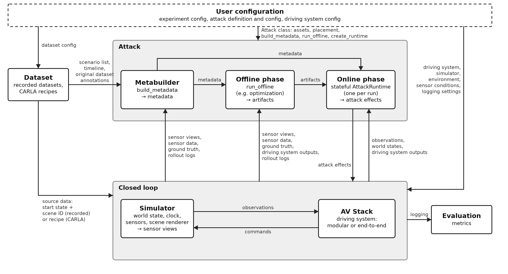

# AVSecTester

Adversarial security testing for autonomous driving.

AVSecTester selects segments, prepares artifacts, executes unattacked and attacked treatments, and
evaluates saved logs. It connects simulators and driving systems through a reusable
experiment workflow.



## Quick start

Complete [installation](docs/getting-started/installation.md) first, including Compose settings,
the required model weights and the selected dataset.

For CARLA:

```bash
docker compose up -d carla-server carla-experiment
docker compose exec carla-experiment avsectester run configs/carla_phantom.yaml
```

For NuRec:

```bash
docker compose run --rm nurec-experiment run configs/nurec_stop_sign_patch_modular_2601.yaml
```

The [quickstart](docs/getting-started/quickstart.md) covers first runs, saved preparation and
evaluation. The [supplied configurations](docs/examples/README.md) describe the
available workflows.

## Documentation

| Goal | Document |
|---|---|
| Install images, weights and data | [Installation](docs/getting-started/installation.md) |
| Run a supplied attack workflow | [Examples](docs/examples/README.md) |
| Understand terms and dependency layers | [Architecture](docs/concepts/architecture.md) |
| Prepare, execute and resume | [Experiments](docs/guides/experiments.md) |
| Write an attack | [Attacks](docs/guides/attacks.md) |
| Integrate a driving system | [Driving systems](docs/guides/driving-systems.md) |
| Configure components | [Configuration](docs/reference/configuration.md) |
| Use commands and automatic services | [CLI](docs/reference/cli.md) |
| Look up public contracts | [Python API](docs/reference/python-api.md) |
| Contribute | [Contributing](docs/development/contributing.md) |

The [documentation index](docs/README.md) lists the full reading paths.

## Status

The framework supplies CARLA closed-loop simulation, NuRec closed-loop reconstruction with
optional reactive traffic, and recorded nuScenes playback. Driving systems include
`ModularAVStack`, `CameraForwardCollisionAVStack`, `AlpamayoAVStack` and `RuleBasedAVStack`. See
the [supported combinations](docs/concepts/architecture.md#supported-configurations).

Defense treatments are **Not yet implemented.** See
[defenses](docs/development/TODO.md#defenses). Rolling-shutter rendering is **Not yet
implemented.** See
[rolling-shutter rendering](docs/development/TODO.md#rolling-shutter-rendering).

## License

MIT; see [LICENSE](LICENSE).
