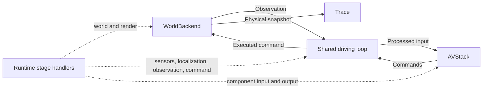

# Development

## Design principle: no parallel definitions

AVSecTester connects simulation, driving systems and security methods through shared interfaces.
Adapters reuse provider actors, sensors, model components, configuration registries and native
hooks. This repository owns scenario preparation, intervention preparation/execution and the
messages exchanged between the world and driving system. When a missing capability belongs to
avstack, add it to the avstack fork.

Concretely:

- The driving loop uses the **pure data plane** (`Observation`/`Control`/`Trace` in `plane.py`)
  and **two interfaces** (`WorldBackend`/`AVStack` + `run` in `backend.py`). Scenario selection,
  insertion geometry and evaluation expose additional research-facing APIs in this repository.
  They reuse provider state and do not replace simulator actors or driving-model modules.
- The modular AV system is an **avcarla `CarlaMobileActor`** driven by an **avstack
  `ModularDrivingPipeline`**; the end-to-end one is NVIDIA's real **Alpamayo-1.5** model.
- CARLA world, traffic and ticking use **avcarla `CarlaClient` / `CarlaNpc`**. The NuRec adapter
  advances the ego with local planar dynamics and requests reconstructed views from NVIDIA's
  **`nre-ga`** renderer. Other actors follow recorded trajectories.
- Attack and defense can implement **`Intervention`** to prepare reusable artifacts, then create
  **`Runtime`** stage handlers with shared lifecycle management. Direct runtime handlers remain
  available. Modular handlers bridge avstack pre/post hooks. `perturb(Observation)` remains an
  input shorthand.
- **`ScenarioConditions`** separates shared environment settings from interventions that vary
  across treatments. World settings belong to backends, while sensor conditions use runtime hooks.

## Architecture

The spine is one loop over a data plane. Adapters compose when their sensor, state and command
formats agree. The supported combinations and remaining adaptation work are listed in
[INTERFACE.md](INTERFACE.md#1-backend-and-stack-compatibility).

Configured entry points use `scenario_from_config` to prepare a `ScenarioInstance`. Without
selection, a pass-through source yields one configuration without preview and `match=None`.
Selection sources evaluate prescribed candidate frames and return an optional `ScenarioMatch`.
Intervention preparation receives the complete scenario. Runtime's `context.case` carries the match.
Filters stop at that boundary. Runtime insertion uses fixed identities and updates placement from
the current pose.

`Intervention.prepare(scenario)` creates artifacts, and `hooks(artifacts)` creates execution
handlers. `run_prepared` executes named treatments, sharing the origin and scenario conditions.
`run_configured` assembles this path from existing YAML/Python configuration and supports single
or paired runs. Direct `run` and `run_pair` remain available. See [SCENARIOS.md](SCENARIOS.md) and
[INTERVENTIONS.md](INTERVENTIONS.md) for the public preparation and execution contracts.



`run`, visualization recording and component logging share this loop. Runtime handlers replace
stage values before downstream consumption. Unsupported stages and declared command-mode
incompatibilities fail before reset. A command-conversion hook defers mode checking to the final
command. Observation state and physical state remain independent. Handler diagnostics are copied
to `Trace.outputs` through `context.record_output(name, value)`. See
[INTERVENTIONS.md](INTERVENTIONS.md) for callback types, lifecycle and native resources.

The CARLA closed-loop driving pieces were contributed upstream into the forks (see
[`INTERFACE.md`](INTERFACE.md) §"What comes from avstack / AlpaSim"): `ModularDrivingPipeline`,
`ForwardCollisionPlanner`, and the `CarlaMobileActor` control loop. The NuRec renderer and the
Alpamayo model come from NVIDIA AlpaSim (`nre-ga`, `alpasim_driver`); `NuRecRenderer` and
`AlpamayoAVStack` are thin adapters behind the `WorldBackend`/`AVStack` interfaces.

## Layout

```
avsectester/
  plane.py            Observation · Control · WorldSnapshot · StateEstimate · Trace   (pure data)
  backend.py          WorldBackend · AVStack · run(...)             (interfaces + loop)
  runtime.py          Runtime · Hook · Plugin · contexts            (intervention execution)
  preparation.py      Intervention · PreparedIntervention · Treatment · artifact storage
  interventions.py    ObservationTransform · NativeHook · configuration/preparation adapters
  conditions.py       ScenarioConditions · SensorCondition   (shared environment settings)
  experiment.py       run_configured · driving factory · execution/treatment selection
  runner.py           run_pair · run_prepared   (shared origin, fresh stacks, cleanup)
  insertion.py        Insertion · placement/orientation · asset surfaces · pose resolution
  carla_runner.py     run_scenario · run_scenario_pair   (CARLA + modular stack assembly)
  perturbations/      image corruptions · frame_perturbation   (observation transforms)
  rendering/          insertion/compositing · cameras · shared visibility geometry
  simulators/                                            (WorldBackend implementations)
    carla.py          CarlaBackend + camera_view (ImageData) · lidar_bev   (CARLA + its view adapters)
    nurec.py          NuRecBackend · Renderer · StubRenderer · NuRecRenderer · dynamics
    viz.py            record_run · detections_view · filmstrip · save_gif   (generic scene pipeline)
  stacks/                                                (AVStack implementations)
    modular.py        ModularAVStack (avstack ModularDrivingPipeline)
    alpamayo.py       AlpamayoAVStack (wraps alpasim_driver Alpamayo-1.5)
  scenarios/          configured and selected scenarios   (see SCENARIOS.md)
    setup.py          scenario_from_config · source_from_config · pass-through source
    source.py         ScenarioInstance · DatasetFilter · CarlaScenarioBuilder
  evaluation/         robustness harness + component logging   (see AUGMENTATION.md, COMPONENT_LOGGING.md)
  attacks/
    adaptive.py       SpeedFeedbackAttack   (reference stateful intervention)
    pipeline/         Internal pipeline attacks: PhantomInjection (avstack HOOKS hook)
    patch/            Physical patch textures, configuration and deployment
    object_insertion/ Traffic signs, pedestrian images and traffic lights
    optim/            Shared PGD/NES algorithms, perturbations, objectives and scorers
  metric.py           impact(clean, attacked) -> Impact + plot_impact  (verdict + its figure)
  cli.py              `avsectester run ...`
```

Attack modules are grouped by function. Shared geometry and harmonization live in `rendering`,
while backend adapters live in `simulators`. Observation transforms live in `perturbations`.
For example, import `PhysicalPatch` from `avsectester.attacks.patch.physical_patch` and `SignAsset`
from `avsectester.attacks.object_insertion.sign_spoof`. The top-level
`from avsectester.attacks import PhantomInjection` entry point remains lazy; its implementation is
in `avsectester.attacks.pipeline.phantom`.

## Extending

| Contribution | Interface and responsibility |
|---|---|
| World backend | Implement `WorldBackend.reset`, `step`, independent `ground_truth`, and resource cleanup. Declare supported command modes and runtime stages. Implement `configure_conditions` for supported world settings. |
| Driving system | Implement `AVStack.__call__(observation) -> Control`, optional reset, and `command_modes`. Expose actual component stages, models and native resources when relevant. Keep heavy imports lazy. |
| Attack or defense | Implement `Intervention.prepare(scenario)` and `hooks(artifacts)` for reusable preparation, or register Runtime hooks directly. Return the downstream value and manage per-run history through Plugin lifecycle methods. |
| Shared sensor condition | Supply a fresh `SensorCondition` handler factory. Keep its operating settings independent from treatment-specific attack/defense variables. |
| Selection filter | Implement `Constraint.evaluate(context) -> FilterResult`. Use normalized state, raw metadata, native APIs or conditioned measurements as appropriate. |
| Dataset or candidate provider | Supply prescribed candidate states, stable actor IDs, scoped native resources and a factory recreating the accepted origin. |
| Inserted asset | Implement `planes()` using asset-local `PlaneSurface` rectangles, then use `Insertion` for placement and the shared geometry for rendering/visibility. |

A custom driving system can enter Python runs through `stack_factory()` or configured runs through
`stack.factory`/`stack.options`. Custom world adapters enter scenario setup through
`backend_factory(scene_config)`. A shared interface does not convert incompatible sensor/state
formats or commands automatically. Built-in command modes are `actuator` and `trajectory`.
An explicit command hook can provide conversion. A custom adapter leaving `command_modes=None`
retains its own validation semantics.

For modular methods, `NativeHook` adapts avstack registered hooks. The `attacks:` shorthand binds
post-hooks at `perception`, `tracking`, `planning` or `control`. Pre-hooks require an explicit
`runtime.hooks` entry such as `perception.pre`, with `CallInputs` returned to the downstream
component. New modular driving behavior belongs in the avstack planning/control modules and
pipeline configuration.

`SpeedFeedbackAttack` demonstrates run-local state and `after_step` feedback. Its purpose is to
illustrate the adaptive interface, not a validated physical attack model. Runtime allows access to
observations, true ego snapshots and native provider APIs. Record diagnostics with
`context.record_output(name, value)` without changing the stage's output contract.

For CARLA scenes, begin with `configs/carla_scenario.yaml`. For selection and custom-provider
ownership, see [SCENARIOS.md](SCENARIOS.md). For supported stages, artifacts, state reset and
factory configuration, see [INTERVENTIONS.md](INTERVENTIONS.md). A handler that acquires native
resources should do so in a lifecycle callback and release them in `close`, rather than relying
on construction-time resources being covered by an execution session that has not begun.

## Testing

Install the dependencies described in [tests/README.md](../tests/README.md). The `core` and
`avstack` directories run in CI; live tests are selected explicitly.

```bash
python -m ruff check avsectester scripts tests
python -m mypy            # data contracts and runtime
python -m pytest -q        # offline: interface + attack hook + pipeline + NuRec + viz, no CARLA/GPU
avsectester run configs/carla_scenario.yaml --frames 40   # CARLA end-to-end: needs a server + weights
python -m scripts.demos.nurec.alpamayo_nurec_demo 8 --save-frames     # Alpamayo+NuRec (driver env; needs nre-ga + a scene)
```

Use focused tests for the behavior changed, including downstream consumption, state reset,
unsupported capabilities and resource cleanup. Scenario and preparation tests can use in-memory
providers and `StubRenderer`. Live tests should establish simulator/renderer behavior that an
offline fixture cannot verify. Test layout and environment commands are maintained in
[tests/README.md](../tests/README.md).

## Roadmap

Deferred implementation issues are tracked in [TODO.md](TODO.md).
