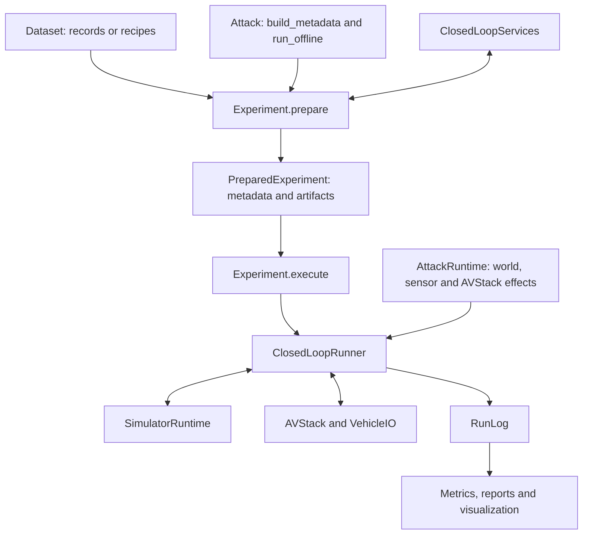

# Architecture

> **Audience:** Experiment authors and contributors.
>
> **Outcome:** Understand component boundaries, the attack workflow and recorded evidence.
>
> **Prerequisites:** None.

## Components

AVSecTester owns experiment orchestration and adapter contracts. Simulators and driving models
retain their native implementations.

| Component | Owns | Does not own |
|---|---|---|
| Dataset | Immutable recorded data or a scenario recipe | Simulator state or generated frame caches |
| Simulator | Reusable settings and capability declarations | An active world |
| SimulatorRuntime | World, clock, actors, sensors and captured observations | Selection metadata or attack algorithms |
| AVStack | Driving inference and per-run history, including VehicleIO | Simulator time |
| Attack | Parameters, input assets, selection and optional optimization | Mutable online history or stored artifacts |
| AttackRuntime | One run's online attack state and effects | A time-advancing closed-loop service |
| HookSet | Ordered hook handlers and their per-run lifecycle | Attack selection |
| VehicleIO | sensors.post hooks, localization and observation hooks | Sensor environment transforms or physical state |
| ClosedLoopServices | Isolated sensor, render, component and rollout operations | Active-run advancement |
| ScenarioView | Scenario timeline, frame data, services and selection reasons | Dataset mutation |
| Experiment | Preparation, treatments, resource scopes and persistence | Attack-specific selection criteria |
| RunLog | Independent snapshots and persistent records | Live SDK handles |
| Metric | Calculations over saved comparison groups | Simulation or additional inference |

## Code layout and dependencies

| Path | Responsibility |
|---|---|
| attack/attack.py, runtime.py, segments.py, placement.py | Attack contracts and core data types |
| attack/insertion/ | Framework assets, projection, visibility, compositor and harmonizers |
| attack/optimization/ | Generic optimization contracts, PGD, NES, perturbations and SessionScorer |
| attack/implemented_attacks/<class_name>/ | One concrete attack per snake_case class folder |
| closed_loop/avstacks/ | Modular, Alpamayo, camera policy, native hooks, mmdet3d.py and scorers |
| geometry/ | Shared camera and rigid-pose mathematics |
| experiment/, runlog/, evaluation/ | Orchestration, recording and log-only analysis |

The attack package has three layers: core contracts, framework tools and concrete attacks. Core
imports neither tools nor concrete attacks. The insertion and optimization tools import core and
shared framework interfaces, never each other or concrete attacks. Concrete attacks compose core and
tools and never import one another. Patch-specific optimization orchestration belongs to
implemented_attacks/patch_attack/, rather than the generic optimization tool. Each concrete attack
exports only its Attack subclass from __init__.py. User attacks follow the same layout and
class-name discovery rules as built-ins. See [Attacks](../guides/attacks.md).

## Attack workflow

Every attack follows `build_metadata → run_offline → create_runtime`.

The metabuilder selects `AttackSegment` records through `ScenarioView`; it can use frame data,
simulator sensor views, driving components and candidate rollouts. Offline preparation runs once for
that attack and returns artifacts. The online phase creates a fresh `AttackRuntime` for each run.
Artifacts are passed explicitly to runtime construction and persistence.

There is no framework reselection after optimization. Preserving a selection's visibility, geometry
or placement assumptions is the attack author's responsibility. Framework structure, capability and
effect checks still apply.

## Scenario preparation

Dataset providers remain stateless across simulator execution. CARLA provides a `CarlaRecipe`;
preparation generates its `FrameData` sequence in a separate cache. NuRec and nuScenes provide
recorded actor data. `Dataset.scenario_start()` returns `ScenarioStart` for a selected boundary. The
simulator receives that record, never `AttackSegment` or selection scores.

A segment with N decisions requires N+1 supported timeline states. The final state is the state
after the last decision; it is not an additional driving input. NuRec's decision timeline uses a
fixed configured time step and interpolates recorded trajectories only within their support.

## Physical state and model-visible data

`WorldSnapshot` records actual state. `Observation` contains model-visible sensors, localization and
ego speed. Altering an observation does not move the world. `WorldAttackEffect` changes the world
explicitly; `SensorAttackEffect` changes the current sensor sample; `AVStackAttackEffect` replaces a
value at a declared driving stage. The runner applies the sensors environment before VehicleIO;
VehicleIO does not own those environment transforms. Produced and executed commands are logged
separately.

`WorldSnapshot.ego` and `actors` use `ActorState`: canonical world pose, velocity, category and
optional full extent. `Detection` uses the true capture-time ego frame, independently of model
localization, with x forward, y left and z up. Its origin is the true ego actor origin, not the
bounding-box center. Evaluation transforms truth through StepRecord.physical_pre.ego. These records
permit evaluation after closing the simulator.

## Isolation and comparison

Preparation uses the first configured seed. Each scene's metabuilder sees the original environment
unless it explicitly requests another environment. Experiment base settings are not implicitly added
to selection requests.

Every formal run and candidate rollout creates a new simulator runtime, AVStack history and
AttackRuntime. Clean and attacked treatments in one comparison group share the selected origin,
seed, decision count and deployment tick budget. Required role actors must exist under each seed; a
missing role causes a recorded failure, not reselection.

A service session can reuse one simulator runtime for forward sensor scans without attack effects.
Rendering with effects and candidate rollouts use independent worlds. Resource reservations last
until native cleanup completes. Shared immutable model weights are allowed only when an adapter can
preserve independent histories.

One experiment currently supports exactly one attack. Its treatment environments and
enabled/disabled attack states are compared on common metadata, with all treatment pairs evaluated.

**Not yet implemented.** Comparing multiple attacks in one experiment on shared metadata. See
[TODO](../development/TODO.md#multiple-attacks-on-shared-metadata).

## Supported combinations

| Data and simulator | Driving system | Interpretation |
|---|---|---|
| CarlaDataset + CarlaSimulator | ModularAVStack | CARLA physics and modular driving |
| NuRecDataset + NuRecSimulator | AlpamayoAVStack | Reconstructed views with configured ego dynamics |
| NuScenesDataset + RecordedReplaySimulator | Compatible AVStack | Open-loop recorded playback |

Recorded playback does not respond to driving commands. NuRec's other actors follow recorded tracks.
`TrajectoryFollower` is an ideal trajectory executor, not a physical actuator controller.

## Implementation status

The CLI uses the same Experiment preparation and execution APIs as Python. Concrete attacks,
configuration loading, reusable artifacts, world/sensor environments, Parquet logs, metrics, reports
and log-based visualization use this path.

**Not yet implemented.** Defense treatments and reference defenses. See
[TODO](../development/TODO.md#defenses).

**Not yet implemented.** Reactive NuRec traffic and a physical trajectory controller. See
[TODO](../development/TODO.md#vehicle-dynamics).

## Terminology

| Term | Meaning |
|---|---|
| Metabuilder | `Attack.build_metadata`, the user's selection logic |
| Metadata | All selected `AttackSegment` records for an attack |
| Segment | A decision interval, role bindings and optional placement, score and user data |
| Artifact | Offline output reused by subsequent runs |
| Treatment | A named attack choice and environment override |
| Comparison group | One attack, segment and seed, with its completed treatment logs |
| Role | An attack-defined name bound to stable actor IDs |
| Simulator | Reusable simulator configuration |
| Simulator runtime | One live world created by a Simulator |
| AVStack | A driving system accepting Observation and producing Control |
| DrivingAdapter | Component and scorer bindings over an AVStack factory |
| HookSet | Ordered stage hooks and their per-run lifecycle |
| VehicleIO | sensors.post hooks, localization and observation hooks |
| ClosedLoopServices | Isolated sensor, rendering, component and rollout operations |
| ScenarioView | Selection view of timeline, frame data and services |
| Environment | Explicit `{world, sensors}` settings |
| Decision | One observe, inference, command and simulator advancement cycle |
| RunLog | Persistent steps, initialization/termination events and captured payloads |

## Next steps

Read [Experiments](../guides/experiments.md), [Attacks](../guides/attacks.md) or
[Runtime](../reference/runtime.md).
