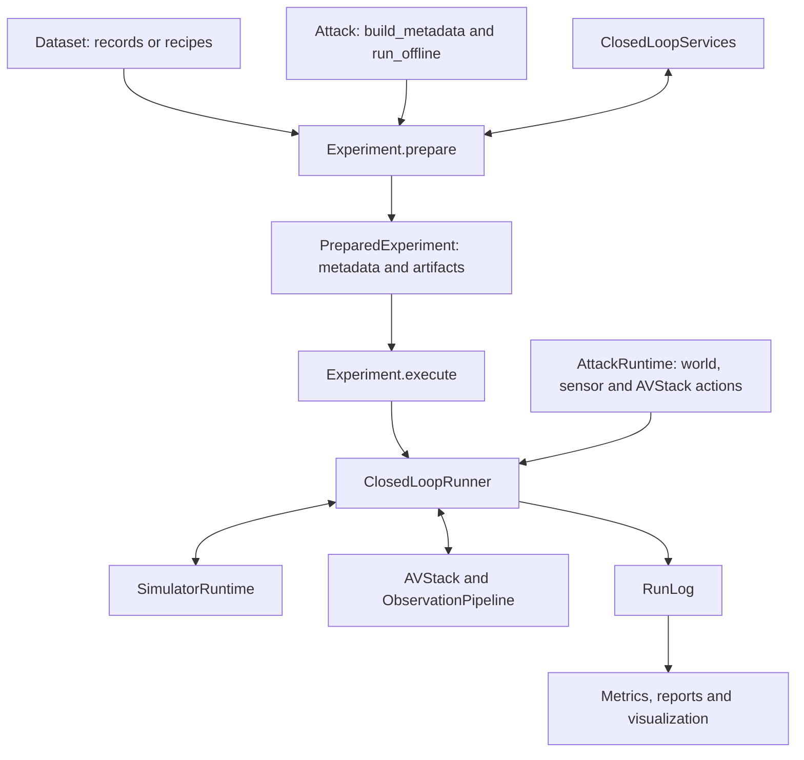

# Architecture

> **Audience:** Experiment authors and contributors.
>
> **Outcome:** Understand component boundaries, the attack workflow and recorded evidence.
>
> **Prerequisites:** None.

## Components

AVSecTester owns experiment orchestration and adapter contracts. Simulators and driving models
retain their native implementations.

| Component | Owns | Does not own |
|---|---|---|
| Dataset | Immutable recorded data or a scenario recipe | Simulator state or generated frame caches |
| Simulator | Reusable settings and capability declarations | An active world |
| SimulatorRuntime | World, clock, actors, sensors and captured observations | Selection metadata or attack algorithms |
| AVStack | Driving inference and per-run history, including ObservationPipeline | Simulator time |
| Attack | Parameters, input assets, selection and optional offline optimization | Mutable online history or stored artifacts |
| AttackRuntime | One run's online attack state and actions, including optional optimization within the run | A time-advancing closed-loop service |
| HookSet | Ordered hook handlers and their per-run lifecycle | Attack selection |
| ObservationPipeline | sensors.post hooks, localization and observation hooks | sensor corruptions or physical state |
| ClosedLoopServices | Isolated sensor, render, component and rollout operations | Active-run advancement |
| ScenarioView | Scenario timeline, frame data, services and selection reasons | Dataset mutation |
| Experiment | Preparation, treatments, resource scopes and persistence | Attack-specific selection criteria |
| RunLog | Independent snapshots and persistent records | Live SDK handles |
| Metric | Calculations over saved comparison groups | Simulation or additional inference |

## Code layout and dependencies

Paths below are relative to avsectester/.

| Path | Responsibility |
|---|---|
| geometry/ | Camera models, rigid poses, box intersections, projection and mesh rays |
| validation.py, type_paths.py, serialization.py | Shared validation, callable imports, JSON serialization and snapshots |
| data_types.py | Shared observations, commands, world/actor states, detections and image targets |
| datasets/ | Stateless recorded data and CARLA recipes |
| maps/ | Semantic-map records and OpenDRIVE/clipgt readers |
| rendering/ | Object surfaces, textures, harmonizers, sampling and composition |
| closed_loop/simulators/base.py | Simulator/runtime contracts, capture lifecycle and sensor views |
| closed_loop/avstacks/base.py, closed_loop/avstacks/driving_adapter.py | Driving-system contracts, ObservationPipeline and component/scorer bindings |
| closed_loop/hooks.py, environment.py, sensor_corruptions.py | Hook lifecycle and explicit world/sensor environments |
| closed_loop/simulators/ego_dynamics.py, navigation.py, ground_contact.py | Ego dynamics, navigation intent and mesh ground contact |
| closed_loop/simulators/object_composition.py | Shared capture composition |
| closed_loop/simulators/carla/ | CARLA simulator, scenarios, sensors, conversions and recipe replay |
| closed_loop/simulators/nurec/ | NuRec simulator, renderer and depth implementation |
| closed_loop/simulators/recorded.py | Recorded open-loop playback |
| closed_loop/avstacks/ | Modular, Alpamayo, camera policy and driving-model scorers |
| attack/attack.py, runtime.py, segments.py | Attack interfaces, metadata and action contracts |
| attack/insertion/ | Insertion actions, assets, placement, visibility and compositing tools |
| attack/optimization/ | Generic optimization contracts, PGD, NES, perturbations and SessionScorer |
| runlog/ | Parquet steps/events, payload shards and readers |
| execution/ | Runner, closed-loop services, attack dispatch and frame cache |
| implemented_attacks/<class_name>/ | One concrete Attack per snake_case class folder, with its own textures |
| evaluation/ | Ordered log-group evaluation, metrics, report records, statistics and visualization |
| experiment/ | Configuration, preparation, treatments and evaluation orchestration |
| experiment/output_directory.py | Saved output layout, prepared artifacts/maps and result loading |
| experiment/type_registry.py, configuration_summary.py | Constructor discovery and configuration descriptions |
| experiment/result_evaluation.py | Order experiment logs, select metrics, attach selections and save reports/plots |
| cli.py | Command-line entry points |

The closed_loop.simulators and closed_loop.avstacks package initializers export interfaces only.
Import concrete implementations from their own simulator or driving-system modules.

The framework separates attack core contracts, reusable tools and concrete attacks. Core imports
neither tools nor concrete attacks. Insertion and optimization tools do not import each other or
concrete attacks. Concrete attacks compose core and tools without importing one another. Patch
optimization orchestration belongs to implemented_attacks/patch_attack/, outside generic tools.
Each concrete attack exports only its Attack subclass from __init__.py. User attacks follow the
same layout and class-name discovery as built-ins. See [Attacks](../guides/attacks.md).

### Dependency layers

Imports within AVSecTester point to the same layer or a lower layer. This applies to imports inside
functions and TYPE_CHECKING blocks as well as module-level imports.

| Layer | Modules | Allowed internal imports |
|---|---|---|
| L0 | geometry/, validation.py, type_paths.py, serialization.py | geometry may import validation; serialization may import type_paths |
| L0′ | data_types.py | L0 |
| L1 | datasets/, maps/, rendering/ | L0–L0′; datasets may import maps, maps must not import datasets |
| L2 | closed_loop/, including simulator and AVStack implementations | L0–L1 |
| L3 | attack/, runlog/ | L0–L2; attack may import runlog |
| L4 | execution/ | L0–L3 |
| L5 | implemented_attacks/ | L0–L4 |
| L6 | evaluation/ | L0–L5 |
| L7 | experiment/ | L0–L6 |
| L8 | cli.py | L0–L7 |

The sole upward reference is attack/attack.py importing ScenarioView and ClosedLoopServices from
execution.services under TYPE_CHECKING for annotations. It performs no runtime import there.
SerializationRegistry encodes and decodes JSON-compatible data and creates independent snapshots.
It remains at L0 because L2 driving adapters also snapshot component outputs. String dataclass
registrations identify classes without eagerly importing their owning modules.

Third-party libraries are outside this internal dependency table. Keep optional SDK, model and GPU
imports lazy within their implementations. rendering/ never imports closed_loop/ or attack/;
both consumers may use it. Shared plane texture sampling lives in rendering/surfaces.py; existing
offline optimization sampling remains a separate approximation.

## Attack workflow

Every attack follows `build_metadata → run_offline → create_runtime`.

The metabuilder selects `AttackSegment` records through `ScenarioView`; it can use frame data,
simulator sensor views, driving components and candidate rollouts. Offline preparation runs once for
that attack and returns artifacts. The online phase creates a fresh `AttackRuntime` for each run.
Artifacts are passed explicitly to runtime construction and persistence.

The online phase is the attack's behavior inside any closed-loop run. A candidate rollout started
during offline preparation creates the candidate's `AttackRuntime` in the same way as an experiment
run. Optimization can therefore happen offline, across queries and rollouts, and online, within
one run.

There is no framework reselection after optimization. Preserving a selection's visibility, geometry
or placement assumptions is the attack author's responsibility. Framework structure, capability and
action checks still apply.

## Scenario preparation

Dataset providers remain stateless across simulator execution. CARLA provides a `CarlaRecipe`;
preparation generates its `FrameData` sequence in a separate cache. NuRec and nuScenes provide
recorded actor data. `Dataset.scenario_start()` returns `ScenarioStart` for a selected boundary. The
simulator receives that record, never `AttackSegment` or attack-specific metadata.

A segment with N decisions requires N+1 supported timeline states. The final state is the state
after the last decision; it is not an additional driving input. NuRec's decision timeline uses a
fixed configured time step and interpolates recorded trajectories only within their support.

## Physical state and model-visible data

`WorldSnapshot` records actual state. `Observation` contains model-visible sensors, localization and
ego speed and navigation route. Altering an observation does not move the world. `WorldAttackAction` changes the world
explicitly; `SensorAttackAction` changes the current sensor sample; `AVStackAttackAction` replaces a
value at a declared driving stage. The runner applies the sensors environment before ObservationPipeline;
ObservationPipeline does not own those sensor corruptions. Produced and executed commands are logged
separately.

NuRec derives navigation from the recorded path and ScenarioStart.scenario_map, then projects the
actual ego pose onto it at each capture. Observation.route is a driving-system input in ego axes;
it does not constrain a planned trajectory. The driving system can request recorded observations
before the selected start through past_steps. NuRec renders those past poses and actor states from
the recording, including world objects present at the start. The runner applies the treatment's
sensor corruptions to that history, without attack actions, stage hooks or ObservationPipeline. Both route and history are model-visible;
physical state remains separate. Insufficient recorded history makes a start ineligible.

`WorldSnapshot.ego` and `actors` use `ActorState`: canonical world pose, velocity, category and
optional full extent. `Detection` uses the true capture-time ego frame, independently of model
localization, with x forward, y left and z up. Its origin is the true ego actor origin, not the
bounding-box center. Evaluation transforms truth through StepRecord.physical_pre.ego. These records
permit evaluation after closing the simulator.

## Isolation and comparison

Preparation uses runs.seeds[0]. Each scene's metabuilder sees the original environment
unless it explicitly requests another environment. Experiment base settings are not implicitly added
to selection requests. The offline context uses the merged runs.environment and attack environment.

Every formal run and candidate rollout creates a new simulator runtime, AVStack history and
AttackRuntime. Clean and attacked treatments in one comparison group share the selected origin,
seed, decision count and deployment tick budget. Each attack checks the actor IDs in its custom
metadata when using them; a missing actor causes a recorded failure, not reselection.

A service session can reuse one simulator runtime for forward sensor scans without attack actions.
Rendering with actions and candidate rollouts use independent worlds. World claims last until
native cleanup completes. SimulatorRuntime defines world_key and claim_world(owner); ownership is
shared within the process for runtimes addressing the same world. exclusive() limits each runtime
to one operation at a time. Shared immutable model weights are allowed only when an adapter can
preserve independent histories.

All attacks finish selection before any offline optimization. Complete identical segments form one
unit across attacks; user_data is part of the canonical identity. An optional seeded split assigns
units to train, validation and test. Only training metadata is passed to offline optimization;
validation_metadata is a separate optional input. PreparedExperiment retains all selected metadata
and the units with their selecting attacks and parts.

One unit and seed form a comparison group. Treatments without attack_name run once per group, and
treatments for every attack selecting that unit are compared in the same group. Offline and online
services share the maximum deployment tick budget across the entire experiment. By default split
executes only test units; without split all units execute.

Splitting is by complete metadata, not by raw images. The same scene/window with different user_data
can enter train and test independently, so test inputs may contain images seen during training.
Sharing un-attacked runs across these distinct units and conditional transfer remain
[planned](../development/TODO.md#shared-runs-across-different-user-data).

## Supported combinations

| Data and simulator | Driving system | Interpretation |
|---|---|---|
| CarlaDataset + CarlaSimulator | ModularAVStack | CARLA physics and modular driving |
| NuRecDataset + NuRecSimulator | AlpamayoAVStack | Reconstructed views with configured ego dynamics |
| NuScenesDataset + RecordedReplaySimulator | Compatible AVStack | Open-loop recorded playback |

Recorded playback does not respond to driving commands. NuRec's other actors follow recorded tracks.
The supplied NuRec configurations use AlpaSimController with linear MPC and its dynamic vehicle model.
TrajectoryFollower remains an explicitly selected ideal trajectory executor.

## Implementation status

The CLI uses the same Experiment preparation and execution APIs as Python. Concrete attacks,
configuration loading, reusable artifacts, world/sensor environments, Parquet logs, metrics, reports
and log-based visualization use this path.

**Not yet implemented.** Defense treatments and reference defenses. See
[TODO](../development/TODO.md#defenses).

**Not yet implemented.** Reactive NuRec traffic and rolling-shutter rendering. See
[TODO](../development/TODO.md#reactive-traffic-in-nurec).

## Terminology

| Term | Meaning |
|---|---|
| Metabuilder | `Attack.build_metadata`, the user's selection logic |
| Metadata | All selected `AttackSegment` records for an attack |
| Segment | scenario_id, a decision interval and attack-specific user_data |
| Artifact | Offline output reused by subsequent runs |
| Treatment | A named attack choice and environment override |
| Unit | One complete segment shared by all attacks selecting identical metadata |
| Comparison group | One unit and seed |
| Simulator | Reusable simulator configuration |
| Simulator runtime | One live world created by a Simulator |
| AVStack | A driving system accepting Observation and producing Control |
| DrivingAdapter | Component and scorer bindings over an AVStack factory |
| HookSet | Ordered stage hooks and their per-run lifecycle |
| ObservationPipeline | sensors.post hooks, localization and observation hooks |
| ClosedLoopServices | Isolated sensor, rendering, component and rollout operations |
| ScenarioView | Selection view of timeline, frame data and services |
| Environment | Explicit `{world, sensors}` settings |
| Decision | One observe, inference, command and simulator advancement cycle |
| RunLog | Persistent steps, initialization/termination events and captured payloads |

## Next steps

Read [Experiments](../guides/experiments.md), [Attacks](../guides/attacks.md) or
[Runtime](../reference/runtime.md).
