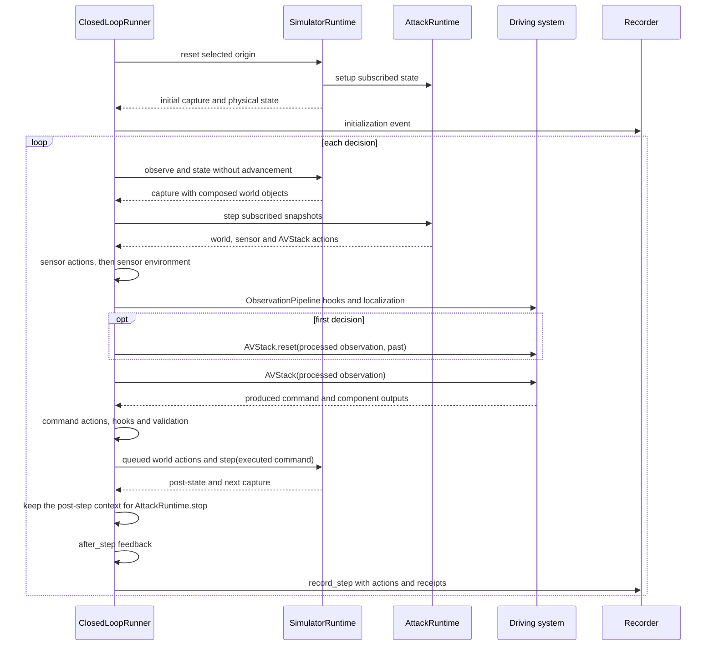

# Runtime reference

> **Audience:** Adapter and attack implementers.
>
> **Outcome:** Look up decision order, stages, contexts and recorded evidence.
>
> **Prerequisites:** [Architecture](../concepts/architecture.md).

## Initialization

The caller creates `SimulatorRuntime` and `AVStack`. The runner validates hook stages,
environments and command compatibility before reset. The simulator prepares the selected origin
using the shared deployment tick budget, applies setup actions and captures the initial
observation. Simulator-specific origin and capture behavior is described
in [Simulators](../guides/simulators.md).

`AttackRuntime.setup` receives its subscribed state and returns zero or more `WorldAttackAction`
values. Actions register cleanup on the supplied `ExitStack`. See budget rules in
[Writing attacks](../guides/attacks.md#online-phase).

Driving-history acquisition follows
[Past observations](../guides/simulators.md#recorded-past-observations). The initialization
event records `past_steps` and each historical observation's `t` and `vehicle_state` without
sensor images.

## One decision



`ObservationPipeline` processes a decision's input once. Decision zero uses that same processed
observation for `AVStack.reset` and the first driving call. The localizer is not reset between
them. World actions returned during a decision affect the next capture. Sensor and `AVStack`
actions affect the current decision.

`InsertObject` is a `WorldAttackAction` with `setup_ticks=0`. A setup insertion appears in the
first capture. A step insertion appears in the next capture. Camera composition precedes
sensor actions, sensor environment and `ObservationPipeline`. Framework objects remain separate
from native actors in `WorldSnapshot.objects`.

### Attack actions

| Action | Boundary |
|---|---|
| `WorldAttackAction` | Simulated-world changes |
| `SensorAttackAction` | Sensor capture changes, including camera, LiDAR, GNSS and IMU |
| `AVStackAttackAction` | Driving-system values from `localization.pre` through `command` |

Sensor actions chain in issue order on independent data, preserving the original capture. Native
wrappers retain calibration and acquisition metadata. Camera buffers remain RGB uint8.
`AVStackAttackAction` rejects `sensors.post`, which remains a normal hook stage. A requested
`AVStack` stage not reached in that decision makes the decision fail.
Action stages are checked when actions are issued. Hook stages and command modes are checked
when each run starts.

### Sensor views

`SensorView.camera` and `cam_from_world` describe optical geometry when available. Optical axes
are x right, y down, z forward. `sensor_from_world` describes the sensor body axes: x forward, y
left, z up. It is `None` when the sensor pose is unavailable. The two transforms are distinct for
cameras. `SimulatorRuntime.sensors` lists all views. `camera_sensors` lists its camera subset.
`SensorView.objects` contains the inserted objects associated with the capture.

### CARLA LiDAR data

A CARLA LiDAR view contains an owned `SensorCapture`. `raw_data` holds packed float32 records x,
y, z, intensity: four values, or 16 bytes, per point. These bytes use CARLA sensor axes: x
forward, y right, z up. `sensor_from_world` uses the canonical body axes whose y points left.

Replacing the capture retains the native `LidarData` wrapper and its `flipy` setting. With
`flipy=True`, the native exporter negates y. Supply replacement points in the original CARLA axes
and preserve the capture's frame, timestamp and metadata.

This action shifts the points one meter forward:

<!-- runnable -->
```python
import numpy as np
from avsectester.attack.runtime import SensorAttackAction
from avsectester.closed_loop.simulators.carla.sensors import SensorCapture

class ShiftLidarPointsAction(SensorAttackAction):
    sensor = "lidar"

    def apply(self, data, view):
        points = np.frombuffer(data.raw_data, dtype=np.float32).reshape(-1, 4).copy()
        points[:, 0] += 1.0
        return SensorCapture(
            native_type=data.native_type,
            raw_bytes=points.tobytes(),
            frame=data.frame,
            timestamp=data.timestamp,
            metadata=dict(data.metadata),
        )
```

Return it from `AttackRuntime.step`. The runner supplies its current capture and `SensorView`.

## Hook stages

`Hook(stage, handler)` accepts a callable or an object with `transform(value, context)`,
where `context` is a `StageContext`.
Handlers execute in registration order and consume preceding replacements. Adapters declare
their supported stages. Unsupported stages fail before reset.

| Stage | Value |
|---|---|
| `simulator.setup` | `None`, native world setup |
| `simulator.step.pre` and `simulator.step.post` | `None`, before/after physical advancement |
| `sensors.post` | `Observation` |
| `localization.pre` | `Observation`, present only with a configured localizer |
| `localization.post` | `StateEstimate` |
| `observation` | `Observation` after localization |
| `perception.pre` and `perception.post` | `CallInputs` or component output, when declared |
| `tracking.pre` and `tracking.post` | `CallInputs` or component output, when declared |
| `planning.pre` and `planning.post` | `CallInputs` or component output, when declared |
| `control.pre` and `control.post` | `CallInputs` or component output, when declared |
| `policy.pre` and `policy.post` | Policy inputs or output, when declared |
| `command` | `Control` before execution |
| `render.pre` and `render.post` | `CameraPoseRequest` or rendered sensor, when declared |

NuRec `render.pre` uses a 4×4 `world_from_rig` pose in `CameraPoseRequest`. The `simulator.setup`
and `simulator.step.*` handlers return `None`. A component pre-hook returns
`CallInputs(args, kwargs)`. A post-hook returns the replacement output. `NativeHook` adapts an
explicitly registered avstack-library hook.

## Contexts and lifecycle

`OnlineContext` exposes `step`, `stage`, `sim_time`, `frame` and optional subscribed
`observation` and `physical_state` snapshots. `record_output` writes named output during a run.
It carries no native runtime or time-advancing service.
Bound `AVStackAttackAction` methods also receive the actual stage value.

`StageContext` exposes `step`, `stage`, `sensor`, `physical_state`, `observation`, `control`, run
resources, `rng` and `record_output`. `simulator_runtime` and `avstack` expose borrowed native
resources. Using native SDK objects ties a handler to that simulator or driving system.

`Plugin.transform` is required. `reset(context)`, `after_step(context)` and `close()`
are optional. `after_step` receives the next raw capture and the post-step clock. `HookSet`
manages each handler owner's lifecycle once, including owners registered at several stages.
Stateful handlers reset per run or are newly constructed. `ObservationPipeline` owns its
localizer, whose lifecycle joins the other handlers.

## Randomness

Sensor corruptions and hooks follow the [randomness rules](../guides/environments.md#randomness).

## Physical and model-visible records

`StateEstimate` contains the model-visible `vehicle_state` and `ego_speed` produced by
localization. Physical snapshots remain separate from these values.

| Record | Fields and coordinates |
|---|---|
| `Observation` | `t`, `frame`, `sensor_data`, `calibration`, `vehicle_state`, `ego_speed`, `route`. Model-visible |
| `Control` | `throttle`, `steer`, `brake`, optional `trajectory` |
| `WorldSnapshot` | `t`, `frame`, `vehicle_state`, `ego_speed`, `ego`, `actors`, `traffic_lights`, `objects`. Physical |
| `ActorState` | world-from-actor `pose`, `velocity`, `category`, optional `extent`, local `box_center` and `box_rotation` |
| `Detection` | ego-frame `position`, full `extent`, `yaw`, `category`, `score` |
| `RecordedOutput` | `name`, copied `value`, decision `step`, `stage`, physical `frame` and `t`, `sensor` |

`ActorState.extent` is full length, width and height in meters. `None` means unavailable.
`box_center` is the actor-local box center. `box_rotation` is local roll/pitch/yaw in degrees.
`box_transform()` combines these with the actor pose to return the world-from-box transform.
Operations requiring dimensions report missing evidence when `extent` is `None`.

`Detection` uses the true capture-time ego frame, independently of driving localization: x
forward, y left, z up, and yaw in radians. `None` detections means unsupported. An empty sequence
means supported with no detections. `WorldSnapshot.traffic_lights` maps map control IDs to `red`,
`yellow`, `green`, `off` or `unknown`. Simulator support is described
in [Simulators](../guides/simulators.md).

## RunLog

Registered dataclasses use JSON objects with `_avsectester_type: "dataclass"`,
`type: "module:Class"` and an encoded `fields` mapping. Mapping-key order is encoded separately.
User mappings containing reserved serialization keys are escaped and round-trip unchanged.
Payload retention defaults are defined in [Configuration reference](configuration.md#recording).

`StepRecord` separates `raw_observation` from `model_observation`, `physical_pre` from
`physical_post`, and `produced_command` from `executed_command`. It also stores `components`,
`detections`, `actions`, `outputs`, `sensor_geometry`, `object_visibility` and `telemetry`. Physical
records retain framework object state.

Action requests and receipts distinguish requested changes from applied changes. A receipt's
outcome is `applied` or `not_applied`, describing the action rather than its driving impact. Every
receipt has a `details` mapping, empty when there is no detail. `InsertionAttackAction` adds
`rendered`, `reason`, `occlusion_source` and `ignored_occluders`. `InsertObject` records
`object_id`, `asset_category` and `world_from_object`.

`StepRecord.object_visibility`, the initialization event and `RenderResult.object_visibility`
use object ID → camera name → `ObjectVisibility`. `ObjectVisibility` contains `occlusion_source`,
`ignored_occluders` and `visible_pixels`. Visibility and composition behavior is described
under [Object visibility](../guides/simulators.md#inserted-world-objects).

`EventRecord` captures initialization, termination and failure/cleanup information outside a
decision. NuRec termination includes `ground_contact_failures`, counts by rejected ground-fit
reason. `RunLog.status` distinguishes `completed`, `failed`, `cancelled` and `incomplete` runs.

Parquet stores typed scalar and nested values. Large arrays occupy payload shards. Payloads
publish before referring record parts. Completion metadata publishes last. A crash leaves
published parts readable and may lose an open part. Readers ignore `*.open` files.

`SerializationRegistry` handles JSON-compatible encoding and independent in-memory snapshots.
Registered dataclasses reconstruct on read. Native values decode to ordinary data. Import and
register user dataclasses before reading them. Missing registrations raise an error identifying
the required registration. Framework registrations use type paths without eagerly
importing SDKs.

This self-contained example stores a user record in a temporary directory:

<!-- runnable -->
```python
from dataclasses import dataclass
from pathlib import Path
from tempfile import TemporaryDirectory

from avsectester.serialization import SerializationRegistry
from avsectester.runlog import Recorder, RunLog

@dataclass(frozen=True)
class CameraCheck:
    sensor: str
    visible_pixels: int

registry = SerializationRegistry()
registry.register_dataclass(CameraCheck)
with TemporaryDirectory() as directory:
    path = Path(directory) / "run"
    with Recorder(path, registry=registry) as recorder:
        recorder.record_event("camera_check", value=CameraCheck("front", 12))
    restored = RunLog.read(path, registry=registry)
    assert restored.events[0].data["value"] == CameraCheck("front", 12)
```

`Recorder` supports bounded chunks and in-memory
retention. Disabling in-memory retention requires a persistent output directory. Reader and
recorder signatures are in the [Python API](python-api.md).

## Failures and cleanup

Unsupported environments are rejected during validation. Unsupported hook stages and command
modes fail each run at its start, producing exit 1. A failing decision stops
attack runtimes, records unapplied actions and cleans run resources. A requested action without
an applied receipt is not evidence of an applied change. An incomplete log is not a
completed run.
