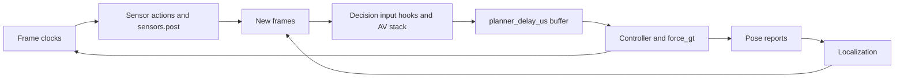

# Runtime reference

> **Audience:** Adapter and attack implementers.
>
> **Outcome:** Look up decision order, stages, contexts and recorded evidence.
>
> **Prerequisites:** [Architecture](../concepts/architecture.md).

## Initialization

The caller creates `SimulatorRuntime` and `AVStack`. The runner validates hook stages,
environments and command compatibility before reset. The simulator prepares the selected origin
using the shared deployment tick budget, applies setup actions and captures the initial
observation. Simulator-specific origin and capture behavior is described
in [Simulators](../guides/simulators.md).

`AttackRuntime.setup` receives its subscribed state and returns zero or more `WorldAttackAction`
values. Actions register cleanup on the supplied `ExitStack`. See budget rules in
[Writing attacks](../guides/attacks.md#online-phase).

Driving-history acquisition follows
[Past observations](../guides/simulators.md#recorded-past-observations). The initialization
event records `past_captures` and each historical observation's `t` and `vehicle_state` without
sensor images.

## One decision

Simulation uses an event queue ordered by `(timestamp_us, priority)`, matching AlpaSim's event
loop. Frame events precede localization, decisions and propagation at the same timestamp.
Computation finishes before virtual time advances. Scheduling and duration calculations use
integer microseconds. NuRec and in-memory `t` values derive from that clock. CARLA preserves its
native floating timestamps and recorded replay preserves dataset timestamps.
[Scheduling](configuration.md#scheduling) owns parameter names and defaults.

Each sensor has an independent `frame_interval_us` clock. Frames end at the origin plus integer
multiples of that interval. A frame event occurs at its end and applies sensor actions, sensor
environments and `sensors.post`. Delivery occurs at frame end. Localization runs
at decision timestamps and `pose_reporting_interval_us` timestamps, using any frames that end
exactly there. A pose timestamp may have no frames. Frame state estimates interpolate this pose
trajectory, sharing the same estimate object when their timestamps coincide.

At a decision timestamp:

1. Acquire frames ending exactly at that timestamp. The raw batch may be empty.
2. Call `AttackRuntime.step`, apply same-frame actions and process the frame batch.
3. Localize the decision pose after `sensors.post`.
4. Transfer all newly ended frames and pose estimates, then apply `observation` hooks.
5. Reset the stack on its first input, then request a command unless driving is skipped.
6. Apply command hooks and add the controller reference to the `planner_delay_us` buffer.
7. Select the buffered reference and propagate one control interval.

Intermediate frame events do not call attack `step`. Persistent sensor actions can affect
those frames. Intermediate pose events run localization without driving inference. Sensor
clocks do not determine the controller's integration or intermediate reporting times.



Feedback (`after_step` and `step.end`) uses the next decision timestamp's raw batch, containing
only frames ending exactly then. It may contain no sensor payloads. The terminal boundary has
physical state and any due raw frames but performs no further attack step, localization or
driving inference. Zero-decision runs process the origin and reset the stack without advancing.

`SimulatorRuntime.configure_timing` sets clocks before reset. `advance_interval` propagates one
control interval and reports poses on `pose_reporting_interval_us`. `capture_at` reads scheduled
sensor frames using their interpolated physical start/end poses. It never adds integration
steps. `state_at` reads interpolated physical truth. `sensor_acquisition` returns a sensor's
latest frame view, retaining its own timestamp and truth.

World actions returned by a decision apply at `simulator.step.pre`, before interval propagation.
Their effects appear in later frames. `InsertObject` has zero setup ticks. Setup insertions are
present in the first capture. Framework objects remain separate in `WorldSnapshot.objects`.

### Delivery and coordinates

`Observation.t`, `vehicle_state`, `ego_speed` and `route` describe the decision timestamp.
`deliveries[sensor_id]` contains this decision's newly ended frames, oldest first. Each
`DeliveredAcquisition` records its frame interval, native frame, payload, calibration, capture ID
and interpolated state estimate. `sensor_data` and `calibration` own the latest frame actually
delivered in this decision. A dropped frame affects only itself. A sensor is absent if no frame
for it was delivered. When every due frame of a sensor was dropped, `deliveries[sensor_id]` is
an empty tuple, so drivers can tell a dropped sensor from one with no frame due.

`state_estimates` contains new localization results through the decision timestamp, oldest
first. Read frames through `delivered(sensor_id)` and poses through `estimated_states()`.
The latest frame reads the current payload and calibration mappings. A frame at the decision's
pose timestamp reads the current `vehicle_state` and `ego_speed`. Earlier estimates remain
unchanged. These accessors compute their results directly, without cached projected state.
Stripped payloads read as `None`. Direct adapter calls synthesize a frame when no delivery record
exists. Unknown sensors raise `KeyError`.

Convert measurements with their frame's pose, not the decision pose. Observation hooks may
replace owner fields before inference. At a pose timestamp that also ends frames,
`localization.pre` edits to payloads and calibration update those frames before delivery.
Pose-only localization receives an independent raw copy. Removing a model-input sensor raises
an error only when the recording policy selects that acquisition.
Raw-only recording can retain a sensor removed from model input.

Frames are handed off once, without payload copies. The framework buffers only ended frames
awaiting the next decision. Driving systems keep their own history. The first input contains
recorded context, and `AVStack.reset(observation)` receives that same input. See
[Recorded input history](../guides/driving-systems.md#recorded-input-history) for the complete
`HistoryRequirement` contract. There is no separate history argument.

### Planner delay and recorded motion

`planner_delay_us` uses AlpaSim's delay-buffer selection. Add each reference with its decision
timestamp. Remove the oldest reference while a second reference is old enough for the delay,
then return the oldest remaining reference. A sole reference is returned immediately, even
before it has aged by the delay. Delay does not introduce a recorded-motion startup period.
`executed_command_issue_time_us` identifies the selected reference's generation time.

Trajectory coordinates retain their generation-time rig frame and timestamps. The controller
resolves them against its ego trajectory, matching AlpaSim's controller reference handling.
The runner does not spatially re-anchor them. Actuator commands have no spatial frame.

`force_gt_duration_us` independently configures recorded motion. A decision is `force_gt` when
its target timestamp belongs to the inclusive interval from the origin through the origin plus
that duration. The duration must be a whole number of decision periods. The controller runs
against recorded reference motion, then recorded dynamics and physics-blended poses override its
output. Frame poses interpolate committed control and report nodes. Traffic interpolates recorded
control nodes. See [NuRec ground contact](../guides/simulators.md#ground-contact) for the blend and
traffic-session origin conventions. At ego handoff, dynamics are aligned to the recording.

During `force_gt`, trajectory systems enqueue a recorded reference. Actuator systems enqueue
the driver's command because they have no recorded trajectory command. Their physical motion
still follows the recording. This is the actuator extension to AlpaSim's trajectory interface.
With `skip_driver_during_force_gt: true`, `ingest(observation)` retains inputs without inference.
Simulators without `trajectory` in their declared `command_modes` reject that option during a
positive force-GT period because no command would be available to enqueue.
Otherwise `__call__` processes them normally. Do not ingest and call the same observation twice.
`StepRecord.force_gt` identifies recorded-motion decisions. Their `executed_command` is the
reference actually tracked for trajectory simulators. It is `None` for actuator simulators that
replay recorded world motion. Driving-system commands still enter the actuator delay buffer.
`DrivingMetrics.brake_steps`, `StopImpact` and the supplied stop-sign black-box stop-command
outcome exclude force-GT decisions. Skipping the driver produces
empty `StepRecord.components` and `not_applied` receipts for actions targeting stages that did not
run.

### Control visibility

At a decision boundary, feedback for the preceding interval finishes before `control` is
cleared. Input processing then sees `control=None`. Raw boundary rendering belongs to the
preceding interval and sees its executed reference. After buffer selection, simulator step
hooks, intermediate hooks and feedback see the actual controller reference. A zero-decision
run processes the origin through sensor environments, capture, localization and observation
hooks without attack `step` or sensor actions.

### Attack actions

| Action | Boundary |
|---|---|
| `WorldAttackAction` | Simulated-world changes |
| `SensorAttackAction` | Sensor capture changes, including camera, LiDAR, GNSS and IMU |
| `AVStackAttackAction` | Driving-system values from `localization.pre` through `command` |

Sensor actions chain in issue order on independent data, preserving the original capture. Native
wrappers retain calibration and acquisition metadata. Camera buffers remain RGB uint8.
`SensorAttackAction.active_for_us=0` applies once to the issuing decision's capture.
`SensorAttackAction` is an ordinary abstract base class. Subclasses may be ordinary classes or
dataclasses, including frozen dataclasses. Declare `active_for_us` as a class attribute or a
subclass field. `InsertionAttackAction` exposes it as a constructor field.
If its sensor has no frame ending then, the action receives `not_applied` with reason
`sensor_not_acquired_at_issue_time`. It does not modify a cached frame or a later acquisition.
A positive duration applies at every due capture in `[issue_time, issue_time + duration)`.
`None` lasts until the run ends. Actions chain by issue order, including overlapping durations.
Each application has its own receipt. An action that expires or stops without encountering a due
frame receives `not_applied`. Supplied image insertion attacks set `active_for_us` to
`OnlineContext.decision_period_us`, covering the issuing decision's full interval.
`OnlineContext.force_gt` reports whether that decision follows recorded motion.
No attack step is called at intermediate captures.
`AVStackAttackAction` rejects `sensors.post`, which remains a normal hook stage. A requested
`AVStack` stage not reached in that decision makes the decision fail. When some sensor had no
frame due in that decision, the action instead receives `not_applied` with reason
`stage_not_executed`.
Action stages are checked when actions are issued. Hook stages and command modes are checked
when each run starts.

### Sensor views

`SensorView.camera` and `cam_from_world` describe optical geometry when available. Optical axes
are x right, y down, z forward. `sensor_from_world` describes the sensor body axes: x forward, y
left, z up. It is `None` when the sensor pose is unavailable. The two transforms are distinct for
cameras. `SimulatorRuntime.sensors` lists all views. `camera_sensors` lists its camera subset.
`SensorView.objects` contains the inserted objects associated with the capture.

`object_masks` maps those same object IDs to boolean H×W masks of visible pixels in `data`.
Each mask's pixel count equals the corresponding `ObjectVisibility.visible_pixels`.
`composition` exists only for composite insertion. It describes how the framework composed
objects into `data`, and `composition.plan.apply(composition.background).image` reproduces it.
Other captures have `composition=None`. `object_occlusion` is `geometry`, `rendered_probes` or
`scene_render`. Scene insertion uses `occlusion_tolerance_m=0.0`. See
[Simulators](../guides/simulators.md#inserted-world-objects) for insertion and visibility behavior.

### LiDAR data

`PointCloud` stores a scan in the sensor coordinate frame at scan end. Its axes are x forward,
y left and z up, with distances in meters. `Observation.sensor_data` stores the cloud and
`Observation.calibration` stores its `LidarCalibration` under the same sensor name.

| Record | Field | Meaning |
|---|---|---|
| `PointCloud` | `points` | Finite float32 array of shape `(N, 3)` in scan-end sensor coordinates |
| `PointCloud` | `intensity` | Float32 array of shape `(N,)` in `[0, 1]`, or `None` when unavailable |
| `LidarCalibration` | `rig_from_lidar` | A 4×4 rigid transform from sensor coordinates to rig coordinates |
| `LidarCalibration` | `spin_period_s` | Calibrated spin period in seconds, used to validate the NuRec capture schedule |

Both records can be saved in `RunLog`. Point and intensity arrays use payload shards.
`sensor_from_world` in a LiDAR view uses the scan-end sensor pose.

This action shifts a framework point cloud one meter forward without changing its intensity:

<!-- runnable -->
```python
from avsectester.attack.runtime import SensorAttackAction
from avsectester.data_types import PointCloud


class ShiftPointCloudAction(SensorAttackAction):
    sensor = "lidar_gt_top_p128"

    def apply(self, data, view):
        points = data.points.copy()
        points[:, 0] += 1.0
        intensity = None if data.intensity is None else data.intensity.copy()
        return PointCloud(points, intensity)
```

Return it from `AttackRuntime.step`. The runner replaces the whole `PointCloud` payload.

### CARLA LiDAR data

CARLA LiDAR keeps avstack's native format, which `ModularAVStack` passes to avstack unchanged.

A CARLA LiDAR view contains an owned `SensorCapture`. `raw_data` holds packed float32 records x,
y, z, intensity: four values, or 16 bytes, per point. These bytes use CARLA sensor axes: x
forward, y right, z up. `sensor_from_world` uses the canonical body axes whose y points left.

Replacing the capture retains the native `LidarData` wrapper and its `flipy` setting. With
`flipy=True`, the native exporter negates y. Supply replacement points in the original CARLA axes
and preserve the capture's frame, timestamp and metadata.

This action shifts the points one meter forward:

<!-- runnable -->
```python
import numpy as np
from avsectester.attack.runtime import SensorAttackAction
from avsectester.closed_loop.simulators.carla.sensors import SensorCapture

class ShiftLidarPointsAction(SensorAttackAction):
    sensor = "lidar"

    def apply(self, data, view):
        points = np.frombuffer(data.raw_data, dtype=np.float32).reshape(-1, 4).copy()
        points[:, 0] += 1.0
        return SensorCapture(
            native_type=data.native_type,
            raw_bytes=points.tobytes(),
            frame=data.frame,
            timestamp=data.timestamp,
            metadata=dict(data.metadata),
        )
```

Return it from `AttackRuntime.step`. The runner supplies its current capture and `SensorView`.

## Hook stages

`Hook(stage, handler)` accepts a callable or an object with `transform(value, context)`,
where `context` is a `StageContext`.
Handlers execute in registration order and consume preceding replacements.
At `sensors.post` and `localization.pre`, `sensor_data` contains only sensors due at that time.
A handler targeting one sensor should leave batches without that sensor unchanged. Adapters declare
their supported stages. Unsupported stages fail before reset.

| Stage | Value |
|---|---|
| `simulator.setup` | `None`, native world setup |
| `simulator.step.pre` and `simulator.step.post` | `None`, before propagation and when its endpoint is published |
| `sensors.post` | `Observation` containing only the sensors due at that acquisition time |
| `localization.pre` | `Observation`, present only with a configured localizer |
| `localization.post` | `StateEstimate` |
| `observation` | `Observation` of delivered inputs at a decision |
| `perception.pre` and `perception.post` | `CallInputs` or component output, when declared |
| `tracking.pre` and `tracking.post` | `CallInputs` or component output, when declared |
| `planning.pre` and `planning.post` | `CallInputs` or component output, when declared |
| `control.pre` and `control.post` | `CallInputs` or component output, when declared |
| `policy.pre` and `policy.post` | Policy inputs or output, when declared |
| `command` | `Control` before execution |
| `render.pre` and `render.post` | `CameraPoseRequest` or rendered sensor, when declared |

NuRec `render.pre` uses a 4×4 `world_from_rig` pose in `CameraPoseRequest`. The `simulator.setup`
and `simulator.step.*` handlers return `None`. A component pre-hook returns
`CallInputs(args, kwargs)`. A post-hook returns the replacement output. `NativeHook` adapts an
explicitly registered avstack-library hook.

## Contexts and lifecycle

`OnlineContext` exposes `step`, `stage`, `sim_time`, `frame`, `decision_time_us`,
`capture_time_us`, `decision_period_us` and `force_gt`, with optional subscribed
`observation` and `physical_state` snapshots. `record_output` writes named output during a run.
The two microsecond fields are set for decision callbacks. Setup and pre-run cleanup can
leave them `None`. It carries no native runtime or time-advancing service.
Bound `AVStackAttackAction` methods also receive the actual stage value.

`StageContext` exposes `step`, `stage`, `sensor`, `physical_state`, `observation`, `control`, run
resources, `rng` and `record_output`. `simulator_runtime` and `avstack` expose borrowed native
resources. Using native SDK objects ties a handler to that simulator or driving system.

`Plugin.transform` is required. `reset(context)`, `after_step(context)` and `close()`
are optional. `after_step` receives the next decision boundary's raw capture and clock.
Intermediate render hooks receive that sensor's acquisition timestamp and viewpoint.
Recorded-history acquisition bypasses render and input hooks. `HookSet`
manages each handler owner's lifecycle once, including owners registered at several stages.
Stateful handlers reset per run or are newly constructed. `ObservationPipeline` owns its
localizer, whose lifecycle joins the other handlers.

## Randomness

Sensor corruptions and hooks follow the [randomness rules](../guides/environments.md#randomness).

## Physical and model-visible records

`StateEstimate` contains the model-visible `vehicle_state` and `ego_speed` produced by
localization. Physical snapshots remain separate from these values.

| Record | Fields and coordinates |
|---|---|
| `Observation` | `t`, `frame`, `sensor_data`, `calibration`, `vehicle_state`, `ego_speed`, `route`, `deliveries`, `state_estimates`. Model-visible |
| `Control` | `throttle`, `steer`, `brake`, optional `trajectory` |
| `WorldSnapshot` | `t`, `frame`, `vehicle_state`, `ego_speed`, `ego`, `actors`, `traffic_lights`, `objects`. Physical |
| `ActorState` | world-from-actor `pose`, `velocity`, `category`, optional `extent`, local `box_center` and `box_rotation` |
| `Detection` | ego-frame `position`, full `extent`, `yaw`, `category`, `score` |
| `RecordedOutput` | `name`, copied `value`, decision `step`, `stage`, physical `frame` and `t`, `sensor` |

`ActorState.extent` is full length, width and height in meters. `None` means unavailable.
`box_center` is the actor-local box center. `box_rotation` is local roll/pitch/yaw in degrees.
`box_transform()` combines these with the actor pose to return the world-from-box transform.
Operations requiring dimensions report missing evidence when `extent` is `None`.

`Detection` uses the true capture-time ego frame, independently of driving localization: x
forward, y left, z up, and yaw in radians. `None` detections means unsupported. An empty sequence
means supported with no detections. `WorldSnapshot.traffic_lights` maps map control IDs to `red`,
`yellow`, `green`, `off` or `unknown`. Simulator support is described
in [Simulators](../guides/simulators.md).

## RunLog

Registered dataclasses use JSON objects with `_avsectester_type: "dataclass"`,
`type: "module:Class"` and an encoded `fields` mapping. Mapping-key order is encoded separately.
User mappings containing reserved serialization keys are escaped and round-trip unchanged.
Payload retention defaults are defined in [Configuration reference](configuration.md#recording).

`StepRecord` separates `raw_observation` from `model_observation`, `physical_pre` from
`physical_post`, and `produced_command` from `executed_command`. It also stores `components`,
`detections`, `actions`, `outputs`, `sensor_geometry`, `object_visibility` and `telemetry`. Physical
records retain framework object state. `executed_command_issue_time_us` identifies the actual
command's production time. `force_gt` marks decisions whose physical motion follows the recording.
`delivered_captures` maps sensors to the capture IDs delivered in that decision. Driving systems
record the frames they actually use in `component_log`. `physical_captures` maps sensors to their
latest physical acquisitions up to the decision, including frames removed by input hooks.
`sensor_geometry` retains recorded cameras when any selected representation keeps them.
`object_visibility` covers the latest physical acquisitions independently of input hooks.
Resolve physical evidence through `RunLog.captures` using `physical_captures`.

`detection_sensor` names the detection source. `detection_capture_id` associates detections with
its latest delivered frame across decisions. Matching truth uses the source's latest physical
acquisition. An undeclared source uses decision truth. Decisions before a named source first
delivers are excluded. A run where it never delivers has unavailable detection evidence.

`CaptureRecord` records a timestamp's due `sensor_ids`, `frame_ranges_us`,
raw and final model observations, physical state, viewpoints and object visibility. Frame ranges
store each sensor's half-open exposure or scan interval. Negative IDs identify recorded
warmup captures, numbered chronologically from `-N` to `-1`. A `DeliveredAcquisition.capture_id` of
`None` means the acquisition was not produced by the scheduler. `RunLog.captures` and
`read_table(..., stream="captures")` expose this stream separately from decisions.

The model observation uses each frame's final payload, calibration and estimated pose from
`delivered(sensor_id)` after localization and `observation` hooks. Owner-field edits apply to the
latest frame in a sensor's delivery. Earlier frames retain their own processed values. Recording
finalizes these inputs before stack reset or invocation, including a zero-decision run. Frames
that do not reach a finalized decision input, including terminal feedback and interrupted input
processing, retain selected raw data and physical metadata without a model observation.

The manifest stores `format_version=2`. Readers also accept version 1 logs without capture
records. Sensor retention is applied per sensor acquisition. Both in-memory and read-back
`StepRecord` delivery entries store metadata without their payloads. Capture records hold the
selected acquisition payloads. Read them through `RunLog.captures` by `capture_id`.
Geometry keys follow `recording.sensor_ids` order. Calibration mappings contain only sensors with
a supplied calibration.
Within each capture, recorder snapshots share equal numeric base NumPy arrays as read-only
values, independent of live inputs. Sharing uses bounded byte comparisons against the same source
and the most recent candidate. Disk storage reuses recorder-owned array identities without hashes.
Native byte payloads also share equal contents within the current capture.
The recorder retains shared arrays until the referencing decision has been snapshotted, including
with `retain_sensor_data=False`. Call `release_captures(capture_ids)` after that snapshot when using
`Recorder` directly. The runner does this automatically without retaining entire observations.
Equal content from different captures may be stored separately. Array subclasses, object arrays
and unsupported buffer dtypes retain independent copies. Copy recorded arrays before editing them.

Action requests and receipts distinguish requested changes from applied changes. A receipt's
outcome is `applied` or `not_applied`, describing the action rather than its driving impact. Every
receipt has a `details` mapping, empty when there is no detail. `InsertionAttackAction` adds
`rendered`, `reason`, `occlusion_source` and `ignored_occluders`. `InsertObject` records
`object_id`, `asset_category` and `world_from_object`.

`StepRecord.object_visibility`, the initialization event and `RenderResult.object_visibility`
use object ID → camera name → `ObjectVisibility`. `ObjectVisibility` contains `occlusion_source`,
`ignored_occluders` and `visible_pixels`.

| `occlusion_source` | Visibility evidence |
|---|---|
| `depth` | Aligned scene depth |
| `actor_cuboids` | Actor box geometry |
| `scene_visibility` | Rendered probes used during composite insertion |
| `scene_render` | Objects rendered together with the scene |

See [Simulators](../guides/simulators.md#inserted-world-objects) for visibility and composition.

`EventRecord` captures initialization, termination and failure/cleanup information outside a
decision. NuRec termination includes `ground_contact_failures`, counts by rejected ground-fit
reason. A run ended by its `terminate_when` predicate records `terminated_by_condition: true`.
`RunLog.status` distinguishes `completed`, `failed`, `cancelled` and `incomplete` runs.

Parquet stores typed scalar and nested values. Large arrays occupy payload shards. Payloads
publish before referring record parts. Completion metadata publishes last. A crash leaves
published parts readable and may lose an open part. Readers ignore `*.open` files.

`SerializationRegistry` handles JSON-compatible encoding and independent in-memory snapshots.
Registered dataclasses reconstruct on read. Native values decode to ordinary data. Import and
register user dataclasses before reading them. Missing registrations raise an error identifying
the required registration. Framework registrations use type paths without eagerly
importing SDKs.

This self-contained example stores a user record in a temporary directory:

<!-- runnable -->
```python
from dataclasses import dataclass
from pathlib import Path
from tempfile import TemporaryDirectory

from avsectester.serialization import SerializationRegistry
from avsectester.runlog import Recorder, RunLog

@dataclass(frozen=True)
class CameraCheck:
    sensor: str
    visible_pixels: int

registry = SerializationRegistry()
registry.register_dataclass(CameraCheck)
with TemporaryDirectory() as directory:
    path = Path(directory) / "run"
    with Recorder(path, registry=registry) as recorder:
        recorder.record_event("camera_check", value=CameraCheck("front", 12))
    restored = RunLog.read(path, registry=registry)
    assert restored.events[0].data["value"] == CameraCheck("front", 12)
```

`Recorder` supports bounded chunks and in-memory
retention. Disabling in-memory retention requires a persistent output directory. Reader and
recorder signatures are in the [Python API](python-api.md).

## Failures and cleanup

Unsupported environments are rejected during validation. Unsupported hook stages and command
modes fail each run at its start, producing exit 1. A failing decision stops
attack runtimes, records unapplied actions and cleans run resources. A requested action without
an applied receipt is not evidence of an applied change. An incomplete log is not a
completed run.
