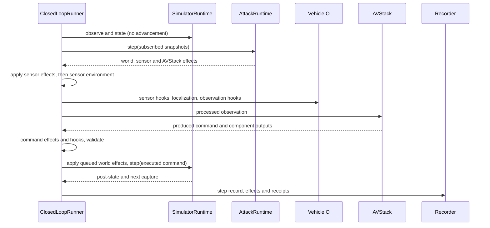

# Runtime reference

> **Audience:** Adapter and attack implementers.
>
> **Outcome:** Look up decision order, stages, contexts and recorded evidence.
>
> **Prerequisites:** [Architecture](../concepts/architecture.md).

## Initialization

The caller creates SimulatorRuntime and AVStack. The runner validates stages, world settings and
command compatibility before resetting the world. For selected CARLA origins, reset follows
prescribed motion without attack hooks to the shared deployment window. simulator.setup applies
world effects, then deployment and capture ticks produce the selected observation. At position zero
these ticks hold base actors. A positive origin earlier than the window is rejected.

AttackRuntime.setup receives subscribed setup state and returns only WorldAttackEffect. Its
setup_ticks declares its deployment budget. Preparation and execution share the maximum budget over
the attack's segments, seeds and treatments. Effects register cleanup on the provided ExitStack. The
simulator runtime records actual initial state; it does not compare against replay-error thresholds
or reselect the origin.

## One decision

Decision zero resets AVStack history with the same already processed observation used for its first
call. Input transforms execute once; the localizer is not reset again. World effects returned during
a decision cannot change its already captured input. They affect subsequent capture. Sensor and
AVStack effects operate on current-decision values.

## Hook stages

A hook is `Hook(stage, handler)`. The handler is callable `(value, StageContext) -> value`, or
provides transform with that signature. Handlers run in registration order, consuming previous
replacements. Adapter-specific stages must be declared; unsupported stages fail before reset.

| Stage | Value |
|---|---|
| simulator.setup | None; native world setup |
| simulator.step.pre/post | None; before/after physical advancement |
| sensors.post | Observation |
| localization.pre | Observation |
| localization.post | StateEstimate |
| observation | Observation after localization |
| perception.pre/post | CallInputs / component output, when declared |
| tracking.pre/post | CallInputs / component output, when declared |
| planning.pre/post | CallInputs / component output, when declared |
| control.pre/post | CallInputs / component output, when declared |
| policy.pre/post | End-to-end policy inputs/output, when declared |
| command | Control before execution |
| render.pre/post | CameraRenderRequest / rendered sensor, when declared |

Simulator setup and step handlers use explicit native operations and return None. A pre-hook uses
CallInputs(args, kwargs) to retain native calling conventions. A post-hook returns the replacement
output directly. NativeHook adapts an explicitly registered avstack-library hook's tuple convention.
It lives in closed_loop/avstacks/native_hook.py.

## Contexts and lifecycle

StageContext exposes step, stage, sensor, physical_state, observation, control, run resources, rng
and record_output. Native access is explicit under simulator_runtime and avstack. A handler that
uses native SDK objects gives up adapter portability.

OnlineContext exposes only subscribed observation/physical_state snapshots and physical time; it
cannot advance simulation. AVStackAttackEffect bound methods also receive the actual stage value.
All online state should remain in one AttackRuntime.

Plugin optionally provides reset(RunContext), transform(value, StageContext), after_step(context)
and close(). Plugin.after_step receives the next raw capture and real post-step clock. HookSet
manages each handler owner's lifecycle once even if registered at several stages. Stateful objects
must reset per run or be newly constructed. VehicleIO owns its localizer, and the dispatcher manages
its lifecycle with other handlers.

## Randomness

HookSet.seed creates a fresh per-run hook RNG. Environment transforms use a separate generator keyed
by run seed, absolute dataset position and transform index. A segment beginning at position p uses
p+i at decision i. Offline requests and formal runs at the same position align their sensor noise.
Native frames can include initialization ticks and are not the dataset position.

## Physical and model-visible records

| Record | Fields and coordinates |
|---|---|
| Observation | t, frame, sensor_data, calibration, vehicle_state, ego_speed; model-visible |
| Control | throttle, steer, brake, optional trajectory |
| WorldSnapshot | t, frame, vehicle_state, ego_speed, ego, other actors; physical |
| ActorState | world-from-actor pose, velocity, category, extent, local box center |
| Detection | ego-frame position, full extent, yaw, category and score |
| RecordedOutput | name, copied value, decision step, stage, physical frame/time and sensor |

ActorState.extent is full length, width and height in metres; None means unavailable. box_center is
the actor-local box center; ActorState.box_pose() returns its oriented world box with optional
extent. Unknown extent is None, distinct from known zero dimensions. Pose-only use remains valid;
operations requiring dimensions report missing evidence rather than substituting zero. Detection
position is its box center in the true ego frame at capture time, using sensor mounting extrinsics,
independently of driving localization, with ego x forward, y left, z up; yaw is radians. None
detections means unsupported, while an empty sequence means supported with no detections.

## RunLog

StepRecord stores raw_observation, model_observation, physical_pre, physical_post, produced_command,
executed_command, components, detections, effects, outputs, typed sensor_geometry and telemetry.
physical_pre and physical_post are StepRecord fields. Effect requests and receipts distinguish what
was requested from what actually applied. EventRecord captures initialization, termination and
failure/cleanup information outside a decision. RunLog.status distinguishes completed, failed,
cancelled and incomplete logs.

Parquet stores typed scalars and nested struct/list values. Large arrays and images occupy bounded
payload shards referenced by records. Each steps/part-NNNNN.parquet and event part is closed before
publication. Payloads publish before referring records; completion metadata is written last. A crash
leaves completed parts readable and can lose the open part of each stream.

Schema version 5 records typed camera geometry under sensor_geometry, with bounding-box offsets
for log-only evaluation.
Readers reject unsupported versions rather than guessing. Persisted native objects decode to plain
data unless a codec explicitly reconstructs a supported type. In-memory capture preserves supported
Python container types and snapshot isolation.

RecordingPolicy(sensor_ids=(), representations=("model_input",), every_n_steps=1) controls sensor
payload retention. State, commands and available component outputs/detections remain per decision.
Recorder supports chunk_steps, chunk_bytes, payload_shard_bytes and retain_steps. Disabling
in-memory retention requires a persistent output directory.

## Failures and cleanup

Unsupported stages, commands and environments are configuration errors. A failing decision stops
attacks, records unapplied effects and cleans resources. Simulator reservations are released only
after native cleanup. Never interpret a requested effect as applied without its receipt, or a
partial log as a completed run.

See [Python API](python-api.md#runlog-api) for readers and recorder signatures.
