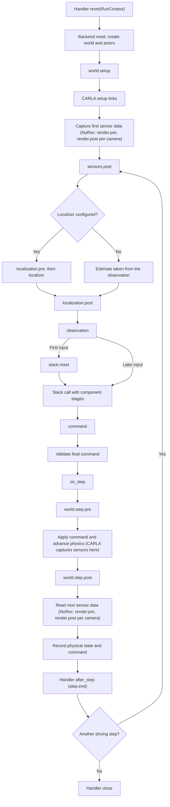

# Runtime reference

> **Audience:** Researchers writing attack, defense, condition or localization handlers.  
> **Outcome:** Look up stages, stage values, execution order, ordering rules, handler lifecycle and the context available to handlers.  
> **Prerequisites:** [Implement an attack](../guides/attacks.md).

A `Runtime` holds the ordered [hooks](../concepts/architecture.md#terminology) of one run, an
optional localizer and a seed for handler randomness. Every driving loop (`run`, `record_run`,
`run_logged`, `run_pair`, `run_prepared`, `run_configured`) executes a `Runtime` with the rules on
this page. Class signatures are in the [Python API reference](python-api.md#runtime).

## Stages

A stage is a named point in the driving loop. Handlers registered at a stage receive the stage's
value and return the value passed downstream.

| Stage | Value | Provided by | When it runs |
|---|---|---|---|
| `world.setup` | `None` | `CarlaBackend`, `NuRecBackend` | Once per run, after the world and actors are created and before the first sensor capture |
| `world.step.pre` | `None` | `CarlaBackend`, `NuRecBackend` | Each driving step, after the final command is validated and before it is applied |
| `world.step.post` | `None` | `CarlaBackend`, `NuRecBackend` | Each driving step, after physics advances and before the next observation is read |
| `render.pre` | `RenderRequest` | `NuRecBackend` | Before each camera is rendered, at reset and after each `world.step.post` |
| `render.post` | RGB image (`ndarray`) | `NuRecBackend` | After each camera is rendered |
| `sensors.post` | `Observation` | Driving loop (always) | First stage of observation processing, on a copy of the raw observation |
| `localization.pre` | `Observation` | Driving loop, only with `Runtime(localizer=...)` | Before the localizer |
| `localization.post` | `StateEstimate` | Driving loop (always) | After the localizer, or after the ideal estimate is taken from the observation |
| `observation` | `Observation` | Driving loop (always) | Last stage before the stack. The result is the model input |
| `perception.pre`, `tracking.pre`, `planning.pre`, `control.pre` | `CallInputs` | `ModularAVStack` | Before the module is called |
| `perception.post`, `tracking.post`, `planning.post`, `control.post` | The module's native output | `ModularAVStack` | After the module's own avstack post-hooks |
| `policy.pre` | AlpaSim `PredictionInput` | `AlpamayoAVStack` | Before `model.predict` |
| `policy.post` | AlpaSim `ModelPrediction` | `AlpamayoAVStack` | After `model.predict`, before the trajectory is built |
| `command` | `Control` | Driving loop (always) | After the stack returns a command, before validation |

Availability rules:

- The driving loop always provides `sensors.post`, `localization.post`, `observation` and
  `command`. Other stages come from `backend.supported_stages` and `stack.supported_stages`.
  `localization.pre` also requires a localizer.
- `ModularAVStack` exposes the `.pre` and `.post` stages only for modules whose call dispatches
  avstack hooks. Alpamayo has no separate perception, tracking, planning or control modules.
- CARLA renders inside its server and does not expose `render.pre` or `render.post`.
- Registration is checked before the world is reset. An unavailable stage raises
  `UnsupportedStageError` (a `ValueError`). `runtime.validate_stages(backend, stack)` performs the
  same check, plus the [command compatibility](#command-compatibility) check, without creating a
  session or invoking handlers. It returns the set of available stages.
- `step.end` is a lifecycle notification for `after_step`, not a stage that a `Hook` can use.
- An adapter that emits a stage outside the available set raises `ValueError`. Custom adapters
  declare and emit stages as described in
  [Write a custom simulator adapter](../guides/simulators.md#write-a-custom-simulator-adapter) and
  [Use a custom driving system](../guides/driving-systems.md#use-a-custom-driving-system).

Sensor capture timing differs between simulators:

| Simulator | When sensor data is produced | Effect of a world change at `world.step.post` |
|---|---|---|
| CARLA | During the server tick, between `world.step.pre` and `world.step.post` | Appears from the following tick, not in the image already captured. Use `world.setup` or `world.step.pre` for a change that must appear in the next observation |
| NuRec | After `world.step.post`, through `render.pre` and `render.post` | Appears in the immediately following rendering |

## Values at each stage

| Value | Fields and meaning |
|---|---|
| `Observation` | `sensor_data` maps sensor IDs to native payloads. `calibration` maps sensor IDs to the adapter's calibration. `vehicle_state` is the model-visible state estimate. `ego_speed` is the model-visible speed in m/s. `t` and `frame` are model-visible clock metadata |
| `StateEstimate` | `vehicle_state` and `ego_speed`, independent of the physical ego state |
| `Control` | `throttle`, `steer`, `brake` and optional `trajectory`. See [Command compatibility](#command-compatibility) |
| `CallInputs` | `args` (a tuple) and `kwargs` (a dict), passed to the module's call. Return a new `CallInputs` to replace arguments |
| `RenderRequest` | `pose` (a copy of the NuRec `EgoPose`) and `camera` (a native camera name). Changing the request changes that rendering without moving the physical ego |
| RGB image | The NuRec renderer's image for one camera. `context.sensor` names the native camera |
| AlpaSim `PredictionInput` | `camera_images`, `command`, `speed`, `acceleration`, `ego_pose_history`, `inference_seed`, `previous_plan` and `route`, as built by `AlpamayoAVStack` |
| AlpaSim `ModelPrediction` | The installed driver's output schema, including `candidate_positions` and `selected_index`. `AlpamayoAVStack` also reads `selected_plan` and `reasoning_text` when present |
| Modular output | The native output type of the configured module, such as detections, tracks, a plan or a control |

Sensor payloads keep their native types. A camera `ndarray`, an avstack `ImageData`, a point
cloud, a radar measurement and a navigation measurement have different fields. A sensor key
added to `sensor_data` affects driving only if the stack or localizer consumes it.

At `render.pre`, a handler can change `request.camera` to render a different native camera. The
image is still stored under the original output key, and that key's calibration follows the
rendered camera. NuRec output keys apply the backend's `camera_aliases`.

### Component inputs

For the supplied avstack `ModularDrivingPipeline`, the component stages receive:

| Component | `CallInputs.args` | `CallInputs.kwargs` |
|---|---|---|
| Perception | The selected sensor payload | Empty |
| Tracking | Detections | `platform`: the estimated ego reference frame |
| Planning | Previous plan, estimated ego state, tracked objects | Empty |
| Control | Estimated ego state, current plan | Empty |

These signatures belong to this pipeline. Other pipelines can use different arguments. Inspect
`stack.native[component]` when writing a handler for a custom module. Pipeline configuration is
described in [Component stages](../guides/driving-systems.md#component-stages).

### Ego state fields

| State field | Value and units |
|---|---|
| NuRec `vehicle_state.x`, `.y` | Planar position in the reconstruction world frame, in metres |
| NuRec `vehicle_state.yaw` | Heading about +Z, in radians |
| NuRec `vehicle_state.speed` | Speed in m/s |
| NuRec `vehicle_state.t` | Simulation time in seconds |
| NuRec `RenderRequest.pose` | An `EgoPose` with the same fields, used for rendering only |
| CARLA `vehicle_state.position.x` | Three position coordinates in metres, expressed in `position.reference` |
| CARLA `vehicle_state.velocity.x` | Three velocity components in m/s, expressed in `velocity.reference` |
| CARLA `vehicle_state.acceleration.x` | Three acceleration components in m/s², expressed in `acceleration.reference` |
| CARLA `vehicle_state.attitude.q` | Native NumPy quaternion, the orientation from its reference to the vehicle frame |
| CARLA `vehicle_state.t` | State timestamp in seconds |

The CARLA adapter converts CARLA's left-handed coordinates to avstack's right-handed coordinates.
The ego vectors use the global reference frame. Preserve the reference graph when changing a
vector or quaternion, and update linked pose or box data when your method requires it. A CARLA
estimated-position offset:

<!-- runnable -->
```python
from avsectester.runtime import Hook, Runtime

def offset_position(estimate, context):
    estimate.vehicle_state.position.x[0] += 5.0
    return estimate

runtime = Runtime([Hook("localization.post", offset_position)])
```

Fields are not synchronized automatically. The supplied modular controller computes speed from
`vehicle_state.velocity`. `AlpamayoAVStack` reads the scalar `ego_speed` and the pose fields `x`,
`y` and `yaw`. To spoof speed consistently, change the velocity vector and set `ego_speed` to its
norm. An experiment may make them inconsistent on purpose. A changed field affects only the
components that read it.

### Trajectory commands

`TrajectoryFollower` reads `Control.trajectory` as a sequence of
`((x, y, z), (w, x, y, z), timestamp_us)` waypoints:

- Positions are in the current rig frame: X forward, Y left, Z up, in metres.
- Quaternions use `wxyz` order. The follower does not read them.
- Timestamps are absolute simulation time in microseconds.
- The follower uses X and Y only. It interpolates from the current rig origin to the first
  waypoint, so a physics step shorter than the waypoint interval does not jump to that waypoint.
  A target time after the last waypoint uses the last waypoint.
- An empty or `None` trajectory makes the ego coast to a stop at `decel` (default 4.0 m/s²).

`AlpamayoAVStack` builds waypoint timestamps from the model-visible `observation.t`. Other
backends may require a different trajectory adapter. Dynamics options are described in
[Dynamics and time step](../guides/simulators.md#dynamics-and-time-step).

### Calibration

The modular stack uses the calibration and reference frames carried by avstack sensor wrappers.
CARLA exposes the same calibration object in `observation.calibration[sensor_id]`. Camera
calibration includes `P`, the image shape and `reference`. LiDAR calibration includes its
`reference`. Fields keep their avstack types and coordinates. Sensors without calibration have no
entry. NuRec uses the renderer's `calibration` mapping, keyed by output camera name. `StubRenderer`
supplies none.

To replace a sensor's calibration, call `observation.set_calibration(sensor_id, calibration)`.
It updates both the mapping and the wrapped payload's `calibration` attribute. Replacing only the
dictionary entry leaves the wrapper pointing to the previous object. An unknown sensor ID raises
`KeyError`. In-place edits of the shared object are visible through both paths. Copies preserve
these aliases within the observation and separate them from the physical sensor settings, subject
to [Native resources and copying](#native-resources-and-copying). Editing calibration does not
move the physical sensor.

## Command compatibility

`backend.command_modes` declares the command representations a backend accepts.
`stack.command_modes` declares the representations a stack can produce.

| Adapter | Command modes |
|---|---|
| `CarlaBackend` | `actuator` |
| `NuRecBackend` with `KinematicBicycle` (the default) | `actuator` |
| `NuRecBackend` with `TrajectoryFollower` | `trajectory` |
| `NuRecBackend` with custom dynamics | The dynamics object's `command_modes`, or `None` |
| `ModularAVStack` | `actuator` |
| `AlpamayoAVStack` | `trajectory` |
| Custom `WorldBackend` or `AVStack` | `None` (undeclared) unless overridden with a `frozenset` |

Rules:

1. Before reset, when both adapters declare modes and the Runtime has no `command` hook, every
   mode the stack produces must be accepted by the backend. Otherwise
   `CommandCompatibilityError` (a `ValueError`) is raised.
2. A `command` hook may convert between representations, so its presence skips the check in
   rule 1. The final command is still validated.
3. After all `command` handlers run, `backend.validate_command(control)` checks the final
   command. A non-`None` `trajectory` requires `trajectory` support. A nonzero `throttle`, `brake`
   or `steer` requires `actuator` support. A neutral command is always accepted.
4. A conversion to actuator commands must set `trajectory` to `None`.
5. An undeclared (`None`) side skips these checks and keeps the adapter's own semantics.
   Custom backends can override `validate_command` for additional constraints.

Built-in actuator dynamics expect `throttle` and `brake` in `[0, 1]` and `steer` in `[-1, 1]`.
Validation checks which fields are active, not their ranges. Changing a field that the selected
dynamics cannot execute is an error rather than a silently inactive attack or defense. Command
conversion does not convert camera, state or coordinate formats. See
[Commands and compatibility](../guides/driving-systems.md#commands-and-compatibility).

## Execution order



- The first observation is processed once. `stack.reset` and the first stack call receive the
  same processed input.
- The observation read after the last driving step is not processed, because no further stack
  call follows.
- `Trace.records` hold the physical state after each step and the executed command. A command at
  step *t* affects only later observations.
- With `frames=0`, handler `reset`, the world, `world.setup`, the first capture (including NuRec
  render stages), `stack.reset` and handler `close` run. No observation-processing stage and no
  driving step runs.
- `on_step(index, seen, control)` receives copies of the processed input and the final command,
  after command validation and before the world advances. Use it for instrumentation. Its copies
  cannot change execution.
- Handler `close` runs on success and on failure. See [Plugin lifecycle](#plugin-lifecycle).

## Ordering at a shared stage

Handlers at different stages run in [execution order](#execution-order), regardless of
registration order. At one stage, handlers run in this order:

| Order | Source | Applies to |
|---|---|---|
| 1 | `perturb` shorthand, prepended by `Runtime.session` | `observation`, in direct `run`, `record_run` and `run_logged` calls |
| 2 | Sensor conditions with `order: before` | `sensors.post` or `observation` |
| 3 | Prepared interventions with `position="before"`, in treatment order | Configured convenience `attacks` (component `.post` stages) and `patches` (`world.setup`) use this position |
| 4 | Base Runtime hooks, in registration order | In configured runs, the raw `runtime.hooks`, enabled only in the `attack` and `attack-defense` treatments |
| 5 | Prepared interventions with `position="after"` (the default), in treatment order | Every configured `interventions` entry, in definition order |
| 6 | Sensor conditions with `order: after` (the default) | `sensors.post` or `observation` |

Rules behind this order:

- `Treatment.runtime(base, case, kinds=...)` assembles rows 3 to 5: `position="before"` hooks,
  then the base Runtime's hooks, then `position="after"` hooks. It keeps the base localizer and
  seed. Each prepared intervention contributes the hooks returned by its `hooks()` method, in
  that order.
- `prepare_from_config` prepares convenience `attacks`, then `patches`, then `interventions`.
  An `interventions` entry has no `position` key, so it always uses `after`.
- Attack and defense entries keep their written order. The `kind` decides only which
  treatments enable an intervention. It never reorders hooks. The framework does not move
  defenses after attacks.
- `ScenarioConditions.apply_runtime(runtime)` adds rows 2 and 6 around the existing hooks.
  `run_prepared` and `run_configured` apply it to every treatment. Direct `run` and `run_pair`
  calls do not, as described in
  [Lower-level execution](../guides/conditions.md#lower-level-execution).
- `Runtime.with_hooks(hooks, prepend=True)` adds hooks before the existing ones, and
  `prepend=False` (the default) after them.
- In the modular stack, runtime component handlers run after the module's configured avstack
  pre-hooks and post-hooks, and before component-logging capture.
- An explicit `treated_runtime` passed to `run_configured` replaces rows 3 to 5 for that
  treatment. Sensor conditions still wrap it.

The effect of rows 2 and 6 on defenses is explained in
[Order relative to attacks and defenses](../guides/conditions.md#order-relative-to-attacks-and-defenses).

## Handler contract

A handler is any of:

- A function `handler(value, context)`.
- An object with `__call__(value, context)`.
- An object with `transform(value, context)`, such as a `Plugin`. `transform` is used when present.

`Hook(stage, handler)` requires a nonempty stage name and a callable handler (or callable
`transform`), and raises `ValueError` or `TypeError` otherwise. Any handler object may also
define the lifecycle methods `reset`, `after_step` and `close`. See
[Plugin lifecycle](#plugin-lifecycle).

The value a handler returns is passed to the next handler at that stage and then downstream.
The runtime checks the returned type at these stages and raises `TypeError` on a mismatch:

| Stage | Required return value |
|---|---|
| `sensors.post`, `localization.pre`, `observation` | `Observation` |
| `localization.post` | `StateEstimate` |
| `command` | `Control` |
| `render.pre` | `RenderRequest` |
| Modular `.pre` stages | `CallInputs` |
| `world.setup`, `world.step.pre`, `world.step.post` | `None`. World handlers act through native operations |
| `render.post`, modular `.post` stages, `policy.pre`, `policy.post` | Not checked. Return a value the downstream consumer accepts |

A localizer is called as `localizer(observation, context)` with `context.stage` set to
`localization` and must return a `StateEstimate`.

A handler may mutate its value or return a replacement. If it returns mutable data borrowed from
native resources, it must copy that data when isolation is needed. Registering a hook does not
change native ownership rules.

The `perturb(observation) -> Observation` argument of `run`, `record_run` and `run_logged` is
shorthand for a one-argument handler at `observation`. It is wrapped in `ObservationTransform`,
which also forwards the wrapped object's lifecycle methods. Prefer `Hook` when a handler needs
the context.

## Plugin lifecycle

| Method | Called | Receives | Purpose |
|---|---|---|---|
| `reset(context)` | Once per run, before the backend resets the world | `RunContext` | Clear per-run state, allocate resources. Actors created by the world reset do not exist yet |
| `transform(value, context)` | At each registered stage | Stage value, `StageContext` | Return the value passed downstream. Required for `Plugin` subclasses |
| `after_step(context)` | After each completed driving step, after the physical state is recorded | `StageContext` with `stage="step.end"` | Update state from feedback. The return value is ignored |
| `close()` | Once per run, after success or failure | Nothing | Release handler-owned resources |

- `Plugin` supplies no-op `reset`, `after_step` and `close`. Any handler object or localizer can
  define these methods without subclassing `Plugin`.
- One handler object registered at several stages, or as a hook and the localizer, has one
  lifecycle per run.
- Participants are reset in hook registration order, followed by the localizer. `after_step`
  follows the same order. `close` runs in reverse order.
- `close` is registered before `reset` is called. If a `reset` raises, `close` still runs for that
  handler and for every handler reset before it.
- In `after_step`, `context.observation` is a private copy of the next raw observation, before
  the next step's input handlers run. `context.control` is a copy of the executed command.
- Resolve actors created by the world reset in `world.setup` or later.
- Intervention factories and `Intervention.hooks` should defer native resources to lifecycle
  callbacks. Preparation that needs its own resources owns and releases them.
- A closure with captured state has no reset. Create a fresh closure and Runtime for every run.

Handler lifecycle and stack lifecycle are separate. The loop calls `stack.reset` once per run.
`AlpamayoAVStack.reset` clears its camera history, previous plan and inference seed.
`ModularAVStack.reset` clears its component-logging captures but does not reconstruct stateful
avstack trackers, planners or controllers. Use a fresh `ModularAVStack` for each independent run.
The runners do this with `stack_factory`.

## Contexts

`RunContext` is passed to `reset`. It holds the run's resources:

| Field | Meaning |
|---|---|
| `backend` | The `WorldBackend` of this run |
| `stack` | The `AVStack` of this run |
| `case` | The [match](../concepts/architecture.md#terminology) (`ScenarioMatch`) or `None`. See below |
| `rng` | The run's NumPy generator. See [Randomness](#randomness) |
| `native` | `{"backend": backend.native, "stack": stack.native}` |

`StageContext` is passed to stage handlers, the localizer and `after_step`:

| Field | Meaning |
|---|---|
| `run` | The `RunContext` |
| `step` | Zero-based driving-step index. Stages inside `backend.step` and `after_step` use the index of the step being executed |
| `stage` | The current stage, `localization` for the localizer, or `step.end` in `after_step` |
| `sensor` | The native camera name for `render.pre` and `render.post`, otherwise `None` |
| `ground_truth` | A fresh, independent `WorldSnapshot` of the physical ego state, taken for each handler call |
| `sim_time` | `ground_truth.t` |
| `observation` | The current observation in the processing chain. `None` during `world.setup` and the first capture. During `backend.step` it is the processed observation of the current step. In `after_step`, the next raw observation |
| `control` | At `command`, the current command in the chain. Elsewhere a copy of the latest command, or `None` before the stack has returned one in the current step |
| `backend`, `stack`, `case`, `rng`, `native` | Shortcuts to the `RunContext` fields |
| `record_output(name, value)` | See [Recording outputs](#recording-outputs) |

Model-visible time and physical time can differ during a clock attack. Use `context.sim_time` or
`context.ground_truth.t` for physical scheduling, not `observation.t`. Editing the `control` copy
outside `command` does not change the executed command.

The `case` is set as follows:

- `Runtime(case=...)` stores an explicit case, which is never replaced.
- `run_prepared` and `run_configured` supply `scenario.match` when the Runtime's case is `None`.
- `Treatment.runtime(case=...)` replaces the base Runtime's case when `case` is not `None`.
- Direct `run` and `run_pair` calls use the Runtime's case unchanged.

`scenario.match` is a `ScenarioMatch`, not the complete `ScenarioInstance`. It is `None` without
selection. Read selected actor IDs through `context.case.binding_ids` and insertion
specifications through `context.case.insertions`. See
[The prepared scenario](../guides/scenarios.md#the-prepared-scenario).

## Read and write interfaces

| Data | Read | Write |
|---|---|---|
| Sensor measurements | `observation.sensor_data[sensor_id]` at `sensors.post` | Return an `Observation` with the payload replaced. Later handlers, the localizer and the stack consume it |
| Model-visible state | `estimate.vehicle_state` and `estimate.ego_speed` at `localization.post`, or the same fields of an `Observation` | Return a modified `StateEstimate` at `localization.post`, or `Observation` at `observation` |
| Model-visible clock | `observation.t` and `observation.frame` | Return a modified `Observation` |
| Calibration | `observation.calibration[sensor_id]` | `observation.set_calibration(sensor_id, calibration)`, then return the observation |
| Driving-system components | The stage value at component stages. `context.stack.native` and `context.stack.models` for handles | Return a replacement value, or mutate a component output |
| Physical ego state | `context.ground_truth`, or `context.backend.ground_truth()` for a new snapshot | Native backend operations in a world-stage handler. Editing a snapshot changes nothing |
| Other actors and environment | Backend native resources in `context.backend.native` | Native operations in a world-stage handler. See [Change the world from handlers](../guides/simulators.md#change-the-world-from-handlers) |
| Rendering (NuRec) | `RenderRequest` at `render.pre`, the image at `render.post` | Return a modified request or image. The physical ego does not move |
| Final command | The `Control` at `command` | Return the `Control` the backend executes |
| Selected scenario | `context.case` | — |

The handler's value is the current value in its chain, including changes made by earlier
handlers. Access is not restricted by attack or defense kind.

Native availability follows adapter initialization:

- CARLA actors exist from `world.setup`.
- The NuRec rendering service is available after the scene loads during reset.
- The first `observation` handlers run before `stack.reset`, so a lazily loaded Alpamayo model can
  be absent from `stack.models` at that point. Passing `model=...` to `AlpamayoAVStack` exposes an
  already loaded model. Reading `stack.models` never forces loading.

## Native resources and copying

- `backend.ground_truth()` returns an independent `WorldSnapshot` with `t`, `frame`,
  `vehicle_state` and `ego_speed` of the physical ego. Editing it does not move the ego. Other
  actors and metadata are available only through native resources.
- CARLA getters reflect the latest completed tick. Native CARLA commands can be asynchronous, so a
  requested world change need not appear immediately in a snapshot or sensor measurement. The NuRec
  ego state is updated synchronously in process.
- The loop calls `backend.copy_observation` on the raw observation before `sensors.post`, and
  again for every `after_step` participant and for `on_step`. The default implementation is a
  deep copy. Copying the observation as one graph keeps shared references within the copy, such
  as calibration aliases, while separating it from the backend.
- A localizer's returned estimate is deep-copied before `localization.post`, so a localizer can
  return cached state without later handlers changing that cache or the backend state.
- Native CARLA sensor captures cannot be deep-copied and stay borrowed. Their Python wrappers,
  calibration and reference graphs are copied. Capture metadata is read-only, but SDK item
  assignment can modify LiDAR and radar points, which affects every holder of that capture,
  including instrumentation copies. To keep the original input, replace the capture in the
  copied wrapper with a private array or measurement the downstream component accepts.
- Editing an observation, including a borrowed capture, never moves simulator actors.
- Native handles are borrowed live resources. The framework does not sandbox their operations or
  undo changes. A handler that creates native resources releases them in `close`.

## Recording outputs

`context.record_output(name, value)` saves a named diagnostic value, such as an attack decision,
a defense alarm or a score, in `trace.outputs`. It does not change the stage value, execution or
any metric. It can be called from stage handlers, the localizer and `after_step`, while the run is
active. It raises `ValueError` for an empty name and `RuntimeError` outside an active callback.

Each record is an `InterventionOutput`:

| Field | Meaning |
|---|---|
| `name` | The name passed to `record_output` |
| `value` | A deep copy of the value at the time of the call |
| `step` | Driving-step index |
| `stage` | Stage of the callback, `localization` or `step.end` |
| `frame`, `t` | Physical frame and time from `ground_truth` at the callback |
| `sensor` | Camera name for render stages, otherwise `None` |

An `observation`-stage output is recorded before the command of its step. A `step.end` output
describes the world after that command. Repeated names create separate records in call order.
Use distinct names, such as `defense.speed_alarm`, when several methods record outputs. Reading
outputs is described in
[Intervention outputs and provenance](../guides/evaluation.md#intervention-outputs-and-provenance).

## Randomness

- `Runtime(seed=...)` creates a fresh `numpy.random.Generator` with
  `numpy.random.default_rng(seed)` for every run. The default seed is `0`. `seed=None` draws
  fresh entropy for each run.
- All handlers and the localizer of one run share this generator through `context.rng`. Adding a
  handler that draws numbers changes the numbers later handlers receive.
- The seed does not configure simulator, driving-model or external-library randomness. Seed
  those through their own APIs.
- Sensor conditions use their own generators, independent of `Runtime.seed`. See
  [Randomness across treatments](../guides/conditions.md#randomness-across-treatments).
- `run_pair`, `run_prepared` and `run_configured` record the seed as `runtime_seed`, and the
  registered stages as `runtime_stages`, in `trace.provenance`.

## World setup ticks

Some world changes need simulator ticks before driving starts. Native CARLA panel deployment
needs one tick per panel before texturing.

- A handler registered at `world.setup` declares its count as an integer attribute
  `setup_ticks`. `Runtime.setup_ticks` is the sum over distinct `world.setup` handlers. Negative
  or non-integer values raise `ValueError`.
- `CarlaBackend.setup_tick()` advances one tick and is allowed only during `world.setup`. After
  the `world.setup` handlers return, the backend performs any remaining declared ticks before the
  first sensor tick.
- In paired and multi-treatment runs, every run uses the largest count among the treatments, so
  all runs start after the same number of ticks.
- Setup ticks precede driving decisions. They are not sensor warmup and are not recorded as
  driving steps. The default count is zero.
- `NuRecBackend` has no `setup_tick()`. `PhysicalPatchPlugin` declares one tick per panel.
