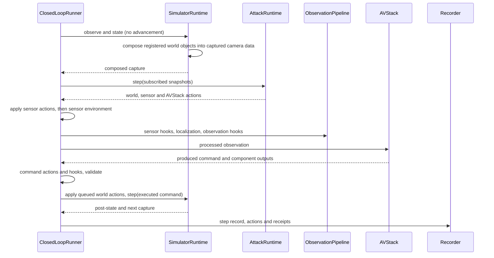

# Runtime reference

> **Audience:** Adapter and attack implementers.
>
> **Outcome:** Look up decision order, stages, contexts and recorded evidence.
>
> **Prerequisites:** [Architecture](../concepts/architecture.md).

## Initialization

The caller creates SimulatorRuntime and AVStack. The runner validates stages, world settings and
command compatibility before resetting the world. For selected CARLA origins, reset follows
prescribed motion without attack hooks to the shared deployment window. simulator.setup applies
world actions, then deployment and capture ticks produce the selected observation. At position zero
these ticks hold base actors. A positive origin earlier than the window is rejected.

AttackRuntime.setup receives subscribed setup state and returns only WorldAttackAction. Its
setup_ticks declares its deployment budget. Preparation and execution share the maximum budget over
all configured attacks, selected segments, seeds and treatments. Actions register cleanup on the provided ExitStack. The
simulator runtime records actual initial state; it does not compare against replay-error thresholds
or reselect the origin.

## One decision



Decision zero resets AVStack history with the same already processed observation used for its first
call. Input transforms execute once; the localizer is not reset again. World actions returned during
a decision cannot change its already captured input. They affect subsequent capture. Sensor and
AVStack actions operate on current-decision values.

InsertObject is a WorldAttackAction with setup_ticks=0. A setup insertion appears from the first
capture; a step insertion appears from the next one. All camera composition happens before sensor
attack actions, sensor environment and ObservationPipeline. state().objects is separate from native
actors,
and StepRecord.physical_pre/physical_post retain those object records in RunLog. The receipt's
details contain only object_id, asset_category and world_from_object. Capture-time visibility is
recorded separately in StepRecord.object_visibility and the initialization event as
object ID → camera name → ObjectVisibility. See
[Insert a world object](../guides/attacks.md#insert-a-world-object).

Attack actions have three boundaries: WorldAttackAction changes the simulated world;
SensorAttackAction changes any sensor capture, including LiDAR, GNSS and IMU; AVStackAttackAction
changes driving-system values from localization.pre through command. Sensor actions chain in issue
order on private data, preserving the original capture. Native data wrappers retain calibration
and acquisition metadata; camera buffers remain RGB uint8. AVStackAttackAction rejects sensors.post.
That stage remains a normal HookSet stage.

SensorView.camera and cam_from_world are optional and only describe optical camera geometry.
sensor_from_world is the world-to-sensor-body transform (x forward, y left, z up), including for
cameras. It is distinct from cam_from_world (x right, y down, z forward) and is None when pose data
is unavailable. SimulatorRuntime.sensors lists all sensor views, and camera_sensors is its subset.
SensorView.objects maps visible object IDs to their PlacedObject values for this camera and capture.
Cuboid-based insertion visibility uses their alpha-aware surfaces alongside the native actor boxes.

### CARLA LiDAR data

A CARLA LiDAR view's data is an owned SensorCapture. Its raw_data buffer contains packed float32
records in the order x, y, z, intensity: four values, or 16 bytes, per point. Coordinates use
CARLA's local left-handed sensor frame: x forward, y right, z up. These raw bytes have not been
flipped; they differ from sensor_from_world's canonical body axes, whose y points left.

Writing a replacement capture retains the native LidarData wrapper and its flipy setting. With
flipy=True, the native export conversion negates y. Return points in the original CARLA axes;
do not pre-flip y and then apply that conversion again. Preserve the capture's frame, timestamp
and metadata when constructing replacement bytes.

This action decodes the points, shifts them one metre forward and returns a new SensorCapture:

<!-- runnable -->
```python
import numpy as np
from avsectester.attack.runtime import SensorAttackAction
from avsectester.closed_loop.simulators.carla.sensors import SensorCapture

class ShiftLidarPointsAction(SensorAttackAction):
    sensor = "lidar"

    def apply(self, data, view):
        points = np.frombuffer(data.raw_data, dtype=np.float32).reshape(-1, 4).copy()
        points[:, 0] += 1.0
        return SensorCapture(
            native_type=data.native_type,
            raw_bytes=points.tobytes(),
            frame=data.frame,
            timestamp=data.timestamp,
            metadata=dict(data.metadata),
        )
```

Return the action from AttackRuntime.step; the runner supplies its current capture and SensorView.

## Hook stages

A hook is `Hook(stage, handler)`. The handler is callable `(value, StageContext) -> value`, or
provides transform with that signature. Handlers run in registration order, consuming previous
replacements. Adapter-specific stages must be declared; unsupported stages fail before reset.

| Stage | Value |
|---|---|
| simulator.setup | None; native world setup |
| simulator.step.pre/post | None; before/after physical advancement |
| sensors.post | Observation |
| localization.pre | Observation |
| localization.post | StateEstimate |
| observation | Observation after localization |
| perception.pre/post | CallInputs / component output, when declared |
| tracking.pre/post | CallInputs / component output, when declared |
| planning.pre/post | CallInputs / component output, when declared |
| control.pre/post | CallInputs / component output, when declared |
| policy.pre/post | End-to-end policy inputs/output, when declared |
| command | Control before execution |
| render.pre/post | CameraPoseRequest / rendered sensor, when declared; NuRec's request pose is the 4×4 world_from_rig rendering pose |

Simulator setup and step handlers use explicit native operations and return None. A pre-hook uses
CallInputs(args, kwargs) to retain native calling conventions. A post-hook returns the replacement
output directly. NativeHook adapts an explicitly registered avstack-library hook's tuple convention.
NativeHook is defined in closed_loop/avstacks/modular.py.

## Contexts and lifecycle

StageContext exposes step, stage, sensor, physical_state, observation, control, run resources, rng
and record_output. Native access is explicit under simulator_runtime and avstack. A handler that
uses native SDK objects gives up adapter portability.

OnlineContext exposes only subscribed observation/physical_state snapshots and physical time; it
cannot advance simulation. AVStackAttackAction bound methods also receive the actual stage value.
All online state should remain in one AttackRuntime.

Plugin optionally provides reset(RunContext), transform(value, StageContext), after_step(context)
and close(). Plugin.after_step receives the next raw capture and real post-step clock. HookSet
manages each handler owner's lifecycle once even if registered at several stages. Stateful objects
must reset per run or be newly constructed. ObservationPipeline owns its localizer, and the
dispatcher manages
its lifecycle with other handlers.

## Randomness

HookSet.seed creates a fresh per-run hook RNG. Sensor corruptions use a separate generator keyed
by run seed, absolute dataset position and corruption index. A segment beginning at position p uses
p+i at decision i. Offline requests and formal runs at the same position align their sensor noise.
Native frames can include initialization ticks and are not the dataset position.

## Physical and model-visible records

| Record | Fields and coordinates |
|---|---|
| Observation | t, frame, sensor_data, calibration, vehicle_state, ego_speed, route; model-visible |
| Control | throttle, steer, brake, optional trajectory |
| WorldSnapshot | t, frame, vehicle_state, ego_speed, ego, actors, traffic_lights and objects; physical |
| ActorState | world-from-actor pose, velocity, category, extent, local box center |
| Detection | ego-frame position, full extent, yaw, category and score |
| RecordedOutput | name, copied value, decision step, stage, physical frame/time and sensor |

ActorState.extent is full length, width and height in metres; None means unavailable. box_center is
the actor-local box center; ActorState.box_transform() returns its oriented world-box-center
transform. Unknown extent is None, distinct from known zero dimensions. Pose-only use remains valid;
operations requiring dimensions report missing evidence rather than substituting zero. Detection
position is its box center in the true ego frame at capture time, using sensor mounting extrinsics,
independently of driving localization, with ego x forward, y left, z up; yaw is radians. None
detections means unsupported, while an empty sequence means supported with no detections.

WorldSnapshot.traffic_lights maps semantic-map TrafficControl IDs to red, yellow, green, off or
unknown. CARLA reads signal actors using their OpenDRIVE IDs; NuRec and recorded replay currently
return an empty mapping. The static map itself is available to selection and saved evaluation,
not to OnlineContext or AVStack input.

## RunLog

StepRecord stores raw_observation, model_observation, physical_pre, physical_post, produced_command,
executed_command, components, detections, actions, outputs, typed sensor_geometry, object_visibility
and telemetry.
physical_pre and physical_post are StepRecord fields. Action requests and receipts distinguish what
was requested from what actually applied. Every receipt has a details mapping, filled when the
action applies and defaulting to {}. InsertionAttackAction adds rendered, reason, occlusion_source
(depth or actor_cuboids) and ignored_occluders (actors without extent). InsertObject adds
object_id, asset_category and world_from_object.

StepRecord.object_visibility, the initialization event and RenderResult.object_visibility map object
ID → camera name → ObjectVisibility for that capture. ObjectVisibility is a frozen record with
occlusion_source, ignored_occluders and visible_pixels. Camera entries follow
[Inserted world objects](../guides/simulators.md#inserted-world-objects). EventRecord captures
initialization, termination and
failure/cleanup information outside a decision. RunLog.status distinguishes completed, failed,
cancelled and incomplete logs.

Parquet stores typed scalars and nested struct/list values. Large arrays and images occupy bounded
payload shards referenced by records. Each steps/part-NNNNN.parquet and event part is closed before
publication. Payloads publish before referring records; completion metadata is written last. A crash
leaves completed parts readable and can lose the open part of each stream.

Records include typed camera geometry under sensor_geometry, with bounding-box offsets for
log-only evaluation. Readers consume the current record layout without legacy-format conversion.
SerializationRegistry provides JSON-compatible encode/decode and independent in-process snapshots.
RunLog, experiment output and driving adapters share it. A registered dataclass encodes as
`{"_avsectester_type": "dataclass", "type": "package.module:Name", "fields": {...}}` and is
reconstructed on read. Field names such as record remain ordinary entries inside fields.
Native objects are registered by their adapters when the adapter module is imported. Persisted native
values decode to ordinary data. snapshot(value) returns detached data, preserving supported Python
containers and native types without converting them through JSON.
DEFAULT_REGISTRY registers framework records by string path without importing simulator SDKs,
AVStack, AlpaSim or torch when the registry is created.

The record layout has changed. Older RunLog files and experiment output directories may no longer
be readable; there is no automatic format conversion.

Register your dataclass before writing it. Before reading a log that contains user records, import
the module defining and registering those records. An unregistered type raises an error explaining
how to register it.

<!-- runnable -->
```python
from dataclasses import dataclass

from avsectester.serialization import DEFAULT_REGISTRY
from avsectester.runlog import Recorder, RunLog

@dataclass(frozen=True)
class CameraCheck:
    sensor: str
    visible_pixels: int

DEFAULT_REGISTRY.register_dataclass(CameraCheck)
recorder = Recorder("example-run")
recorder.record_event("camera_check", value=CameraCheck("front", 12))
recorder.finish()
restored = RunLog.read("example-run")
assert restored.events[0].data["value"] == CameraCheck("front", 12)
```

RecordingPolicy(sensor_ids=(), representations=("model_input",), every_n_steps=1) controls sensor
payload retention. State, commands and available component outputs/detections remain per decision.
Recorder supports chunk_steps, chunk_bytes, payload_shard_bytes and retain_steps. Disabling
in-memory retention requires a persistent output directory.

## Failures and cleanup

Unsupported stages, commands and environments are configuration errors. A failing decision stops
attacks, records unapplied actions and cleans resources. World claims are released only after
native cleanup. Never interpret a requested action as applied without its receipt, or a
partial log as a completed run.

See [Python API](python-api.md#runlog-api) for readers and recorder signatures.

NuRec termination events include ground_contact_failures, a count per rejected ground-fit reason.

Driving systems may declare past_steps. Before the first decision, the runner obtains that many
recorded past observations and applies only the treatment's sensor corruptions at each absolute
dataset position. Past observations bypass hooks, ObservationPipeline and attacks, but contain the
world objects present at the start, such as objects inserted during setup. AVStack.reset
receives them from oldest to newest. The initialization event includes past_steps and
past_observations, containing only each observation's t and vehicle_state, without images.
