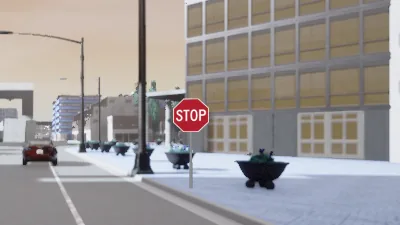
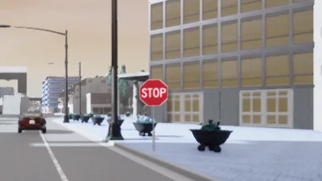
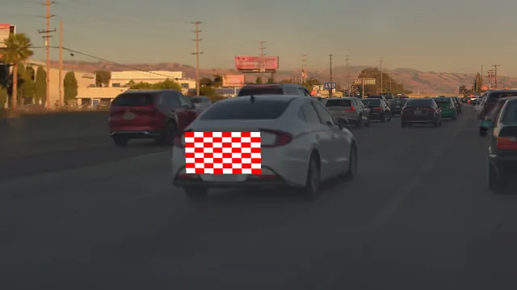
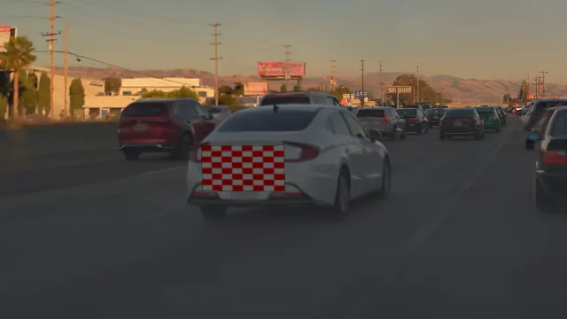
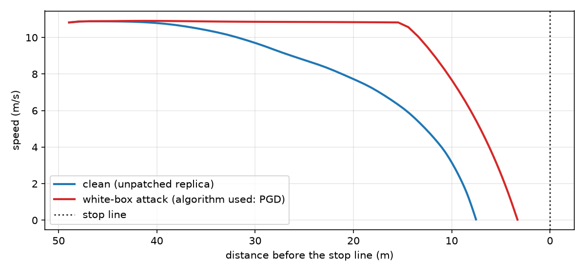
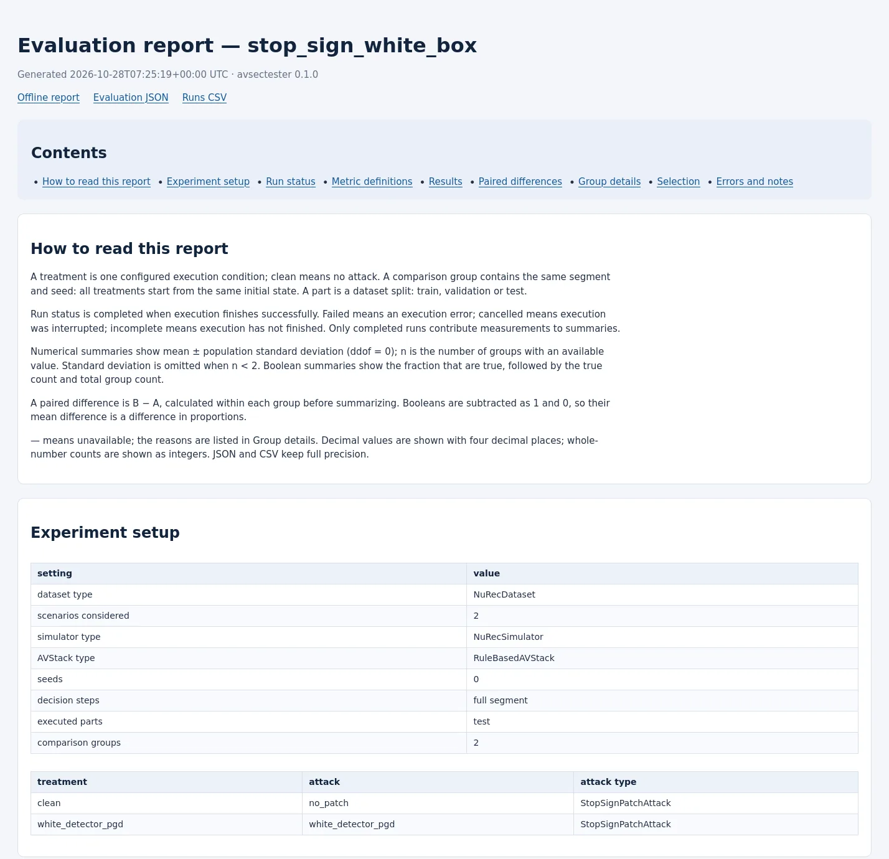

## See it run

<figure class="avs-figure">
  <video class="avs-video" muted loop playsinline autoplay preload="metadata"
         poster="assets/media/stop-sign-white-box.webp"
         aria-label="Side-by-side video of a clean run and a white-box attack run of the same stop-sign approach in a NuRec scene, with the rule-based driving system's stop-sign detections and a speed plot">
    <source src="assets/media/stop-sign-white-box.mp4" type="video/mp4">
  </video>
  <figcaption>In this example run, the rule-based driving system detects the unpatched replica stop sign early
  in the clean run (left). With a patch from a white-box attack (algorithm used: PGD) on its detector
  (right), it detects the sign later, brakes later and stops closer to the stop line; both runs
  stop before the line.</figcaption>
</figure>

## Why closed loop

An attack on perception matters through what the vehicle does next. AVSecTester keeps the driving
system in the loop: its commands move the simulated vehicle, the next observation follows from
that motion, and the attack acts again at every decision.

- Measure driving consequences such as stopping, braking, stop-line distance and collisions.
- Compare clean and attacked treatments of one segment, started from the same origin and seed.
- Record the physical state separately from what the driving system received.

## Features

### Recorded and simulated worlds

Run CARLA scenario recipes, NuRec reconstructions of recorded drives or open-loop nuScenes
playback through one `Simulator` interface.

[Simulators](docs/guides/simulators.md){ .avs-card__link }

### Modular and end-to-end driving systems

Drive with avstack's modular pipeline, a rule-based stop-sign system, a camera collision policy or
Alpamayo, or your own `AVStack`; a `DrivingAdapter` exposes its components and scorers to attacks.

[Driving systems](docs/guides/driving-systems.md){ .avs-card__link }

### Attack lifecycle

A metabuilder selects segments, the offline phase prepares artifacts, and the online phase
returns world, sensor and `AVStack` attack actions in each run.

[Attacks](docs/guides/attacks.md){ .avs-card__link }

### White-box and black-box attacks

Optimize artifacts with gradients of a differentiable score (algorithm used: PGD) or with score
queries alone (algorithm used: NES), through scorers bound to the driving system.

[Optimization](docs/guides/optimization.md){ .avs-card__link }

### Reproducible experiments

Save selected metadata, artifacts and run logs, split segments into training and test units, reuse
a saved preparation and resume interrupted work.

[Experiments](docs/guides/experiments.md){ .avs-card__link }

### Evaluation and reports

Measure driving, stop-line and detection metrics from saved logs, compare treatments pairwise and
write HTML and structured reports.

[Evaluation](docs/guides/evaluation.md){ .avs-card__link }

## Architecture

<figure class="avs-figure" markdown>

<figcaption>The metabuilder, the offline phase and the online phase all use the closed loop of a
simulator and a driving system; every run is logged for evaluation.</figcaption>
</figure>

## Supported components

**Simulators:** CARLA · NuRec · recorded playback (nuScenes) 
**Driving systems:** `ModularAVStack` · `CameraForwardCollisionAVStack` · `RuleBasedAVStack` ·
`AlpamayoAVStack` 
[Supported configurations](docs/concepts/architecture.md#supported-configurations)

## Examples

### Stop-sign patch

<video class="avs-video" muted loop playsinline autoplay preload="metadata"
       poster="assets/media/stop-sign-black-box.webp"
       aria-label="Video of Alpamayo driving a NuRec scene with a patched replica stop sign, overlaid with its planned trajectory and recorded reasoning text">
  <source src="assets/media/stop-sign-black-box.mp4" type="video/mp4">
</video>

In this example run, Alpamayo approaches a replica stop sign carrying a patch from a black-box
attack (algorithm used: NES, reduced budget for illustration). The overlay shows its planned
trajectory and recorded reasoning.

[Stop-sign patch example](docs/examples/stop-sign-patch.md){ .avs-card__link }

### Image object insertion

<figure markdown>

<figcaption>Without harmonization</figcaption>
</figure>
<figure markdown>

<figcaption>With ExposureHarmonizer</figcaption>
</figure>

In these example runs, a stop sign is inserted into the NuRec front-camera image while Alpamayo
drives. Only the camera image changes; the world contains no sign. The two images show the same
decision of runs that differ only in compositing: without harmonization, and with exposure
matching by `ExposureHarmonizer` and slight edge softening.

[Image insertion example](docs/examples/image-insertion.md){ .avs-card__link }

### Physical patch

<figure markdown>

<figcaption>Without harmonization</figcaption>
</figure>
<figure markdown>

<figcaption>With ExposureHarmonizer</figcaption>
</figure>

In these example runs, a checkerboard patch is composited onto the rear of a recorded vehicle in
the NuRec front-camera image while Alpamayo drives. The two images show the same decision of runs
that differ only in compositing: without harmonization, and with exposure matching by
`ExposureHarmonizer` and slight edge softening. In CARLA the same attack deploys a native
physical prop.

[Physical patch example](docs/examples/physical-patch.md){ .avs-card__link }

### Phantom injection

A runtime inserts a synthetic detection at the `perception.post` stage of `ModularAVStack` in
CARLA; the physical world contains no corresponding actor.

[Phantom injection example](docs/examples/phantom-injection.md){ .avs-card__link }

## Evaluation

An experiment output contains the selected metadata, the offline reports, a `RunLog` for every
run and an evaluation report in HTML and structured form. Metrics are computed from the saved logs
without a simulator.

<figure class="avs-figure" markdown>

<figcaption>Speed against distance to the stop line, plotted from the saved logs of the runs shown at the
top of this page.</figcaption>
</figure>

<figure class="avs-figure" markdown>

<figcaption>The HTML evaluation report written for the same experiment.</figcaption>
</figure>

[Evaluation guide](docs/guides/evaluation.md)

## Responsible use

AVSecTester is intended for research and authorized security testing. Attacks run in simulation
and on recorded data. Do not apply them to vehicles, road infrastructure or systems without
permission.

[MIT License](https://github.com/AVSecProject/AVSecTester/blob/main/LICENSE) ·
[GitHub](https://github.com/AVSecProject/AVSecTester)

Media on this page are rendered from the NVIDIA PhysicalAI Autonomous Vehicles NuRec dataset
(NVIDIA Corporation, NVIDIA Autonomous Vehicle Dataset License Agreement). The Alpamayo examples
use NVIDIA Alpamayo 1.5 for research under the NVIDIA License (non-commercial use). The
rule-based driving system detects stop signs with the torchvision Faster R-CNN model trained on
COCO. The replica
face and the inserted sign use the MUTCD R1-1 stop sign, a public-domain traffic control device.

