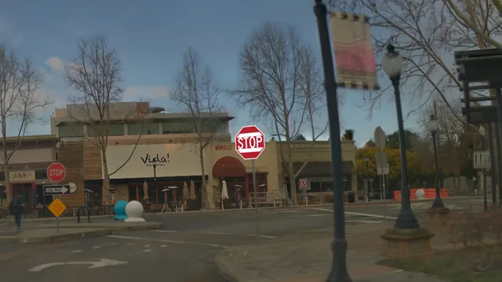
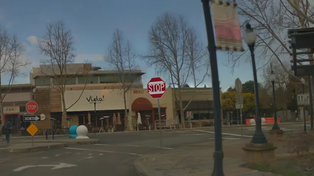

## See it run

<figure class="avs-figure">
  <video class="avs-video" muted loop playsinline autoplay preload="metadata"
         poster="assets/media/stop-sign-white-box.webp"
         aria-label="Side-by-side video of a clean run and a white-box attack run of the same stop-sign approach in a NuRec scene, with the rule-based driving system's stop-sign detections and a speed plot">
    <source src="assets/media/stop-sign-white-box.mp4" type="video/mp4">
  </video>
  <figcaption>Left: the driving system sees the stop sign early and stops before the line. Right: with a
  patch from a white-box attack (PGD) <a href="#references">[1]</a> on its detector
  <a href="#references">[2]</a>, it sees the sign too late and runs the stop line.</figcaption>
</figure>

## Why AVSecTester

AVSecTester tests attacks and defenses the way they would play out on the road: in a vehicle that
keeps driving.

- **Closed-loop rollouts.** Open-loop evaluation can rate a driving system highly even when it
  ignores what is in front of it [[3]](#references). AVSecTester rolls the driving system out in
  closed loop. Its commands move the vehicle, the next camera frame follows from that motion, and
  the attack acts at every step. You see whether the vehicle actually stops, brakes or crashes.
- **Comparable, reproducible experiments.** Every attack runs through the same workflow and one
  YAML file configures the whole experiment. Clean and attacked runs start from the same state, and
  every run is logged, so results can be re-evaluated, compared across attacks and resumed after an
  interruption.
- **Bring your own code.** Add attacks, driving systems or metrics in your own package and
  reference them from the YAML, without changing the framework.

## What you can do with it

AVSecTester is built for people who develop and evaluate autonomous-vehicle security: researchers
who design attacks and defenses, and engineers who test driving systems against them.

<div class="avs-grid avs-grid--four" markdown>

<div class="avs-card" markdown>

### Test a new attack

Does your attack change how the vehicle drives, not just a detection score? Write it in Python or
start from a supplied attack: choose where it applies, optimize it offline and act at every
decision. Each test segment runs clean and attacked from the same start.

[Attacks](docs/guides/attacks.md){ .avs-card__link }

</div>

<div class="avs-card" markdown>

### Stress-test a driving system

How does your driving system behave under known attacks? Wrap it as an `AVStack`. A
`DrivingAdapter` exposes its components to attacks. Run supplied attacks over many drives and get
paired reports of stopping, braking, stop-line and collision outcomes.

[Driving systems](docs/guides/driving-systems.md){ .avs-card__link }

</div>

<div class="avs-card" markdown>

### Optimize an attack

How strong can an attack get? Optimize a patch with gradients through the driving system's own
model (white-box, PGD [[1]](#references)) or with queries only (black-box, NES
[[4]](#references)), then test it on new scenes.

[Optimization](docs/guides/optimization.md){ .avs-card__link }

</div>

<div class="avs-card" markdown>

### Record and replay runs

Every run saves the camera input the driving system received, its outputs and the vehicle's
physical state. Measure, compare, replay and export frames later without running the simulator
again.

[Evaluation](docs/guides/evaluation.md){ .avs-card__link }

</div>

</div>

Defense evaluation is planned. See [Defenses](docs/guides/defenses.md).

## How it works

<div class="avs-steps" markdown>

1. **Choose where to drive.** Use real-world drives reconstructed with NuRec or CARLA scenarios,
   and a supplied driving system or your own.
2. **Choose or write an attack.** It selects the segments it applies to, prepares its artifacts in
   an offline phase and acts on the world, the sensors or the driving system in the online phase.
3. **Run and compare.** One command prepares the attack, runs clean and attacked treatments of
   every test segment in closed loop and writes metrics and an HTML report.

</div>

```yaml
# configs/nurec_stop_sign_patch_modular_2601.yaml, abridged
dataset:
  type: NuRecDataset            # reconstructed real-world drives
simulator:
  type: NuRecSimulator          # commands move the vehicle and the next frame follows
avstack:
  type: RuleBasedAVStack        # or AlpamayoAVStack, or your own AVStack
attacks:
  noise_detector_pgd:
    type: StopSignPatchAttack   # or your own Attack
    options:
      initial_patch: low_frequency_noise
      optimization: ...         # white-box attack (algorithm used: PGD)
runs:
  treatments:
    - {name: clean, attack_name: no_patch}
    - {name: noise_detector_pgd, attack_name: noise_detector_pgd}
```

```bash
docker compose run --rm nurec-experiment run configs/nurec_stop_sign_patch_modular_2601.yaml
```

## Architecture

<figure class="avs-figure" markdown>
[](docs/assets/architecture.png)
</figure>

## Supported components

<div class="avs-components" markdown>

**Closed-loop simulators:** NuRec [[5]](#references)[[6]](#references) with AlpaSim
[[7]](#references) · CARLA [[8]](#references)<br>
**Driving systems:** modular · end-to-end<br>
[Supported configurations](docs/concepts/architecture.md#supported-configurations)

</div>

## Examples

<div class="avs-grid avs-grid--wide" markdown>

<div class="avs-card" markdown>

### Stop-sign patch attack

<div class="avs-pair" markdown>
<figure markdown>

<figcaption>Without harmonization</figcaption>
</figure>
<figure markdown>

<figcaption>With harmonization</figcaption>
</figure>
</div>

A patch is added to a stop sign [[9]](#references) in a NuRec drive while Alpamayo
[[10]](#references)[[11]](#references) drives. Harmonization matches the sign to the lighting of
the scene. Compare it with the real stop sign on the left.

[Stop-sign patch attack](docs/examples/stop-sign-patch.md){ .avs-card__link }

</div>

<div class="avs-card" markdown>

### Object insertion attack

<div class="avs-pair" markdown>
<figure markdown>

<figcaption>Without harmonization</figcaption>
</figure>
<figure markdown>

<figcaption>With harmonization</figcaption>
</figure>
</div>

A stop sign is added to the camera image in CARLA [[8]](#references) while a driving system built
on AVstack [[12]](#references) drives. The world itself has no sign. Harmonization matches the sign
to the lighting of the scene.

[Object insertion attack](docs/examples/image-insertion.md){ .avs-card__link }

</div>

<div class="avs-card" markdown>

### Physical patch attack

<div class="avs-pair" markdown>
<figure markdown>

<figcaption>Without harmonization</figcaption>
</figure>
<figure markdown>

<figcaption>With harmonization</figcaption>
</figure>
</div>

A patch is added to the back of a car in a NuRec drive while Alpamayo drives. Harmonization
matches the patch to the lighting of the car.

[Physical patch attack](docs/examples/physical-patch.md){ .avs-card__link }

</div>

</div>

## Evaluation

An experiment output contains the selected metadata, the offline reports, a `RunLog` for every
run and an evaluation report in HTML and structured form. Metrics are computed from the saved logs
without a simulator.

<div class="avs-grid avs-grid--wide" markdown>

<figure class="avs-figure" markdown>

<figcaption>Speed against distance to the stop line, plotted from the saved logs of the runs shown at the
top of this page.</figcaption>
</figure>

<figure class="avs-figure" markdown>

<figcaption>The HTML evaluation report written for the same experiment.</figcaption>
</figure>

</div>

[Evaluation](docs/guides/evaluation.md)

## Before you try

- **Requirements.** Linux with NVIDIA GPUs, Docker Compose and the NVIDIA Container Toolkit.
  Experiments run in the supplied Docker images. NuRec scenes, NRE images and model weights are
  downloaded separately and need NGC and Hugging Face access. See
  [Installation](docs/getting-started/installation.md).
- **Status.** AVSecTester is an early research release. The supported simulator and
  driving-system combinations are listed in
  [Supported configurations](docs/concepts/architecture.md#supported-configurations).

## Responsible use

AVSecTester is intended for research, education and authorized security testing of autonomous
driving systems. Its attacks run in simulation and on recorded or reconstructed data.

- Do not use the attacks, or physical artifacts produced with them, against vehicles, road
  infrastructure or systems that you do not own or are not authorized to test, and never on
  public roads.
- Follow applicable laws and the terms of the datasets and models you use.
- If you find a vulnerability in a real system, report it to the affected vendor before publishing
  it.
- Results in simulation do not establish that a real vehicle is safe or unsafe. The software is
  provided under the MIT License, without warranty.

## References

1. A. Madry, A. Makelov, L. Schmidt, D. Tsipras and A. Vladu. Towards Deep Learning Models
   Resistant to Adversarial Attacks. ICLR, 2018. [arXiv:1706.06083](https://arxiv.org/abs/1706.06083)
2. Z. Ge, S. Liu, F. Wang, Z. Li and J. Sun. YOLOX: Exceeding YOLO Series in 2021. arXiv
   preprint, 2021. [arXiv:2107.08430](https://arxiv.org/abs/2107.08430)
3. C. Löwens, T. Funke and A. P. Condurache. Driving on Memory. NeurIPS, 2026.
   [arXiv:2608.31029](https://arxiv.org/abs/2608.31029)
4. A. Ilyas, L. Engstrom, A. Athalye and J. Lin. Black-box Adversarial Attacks with Limited Queries
   and Information. ICML, 2018. [arXiv:1804.08598](https://arxiv.org/abs/1804.08598)
5. NVIDIA. PhysicalAI-Autonomous-Vehicles-NuRec. Hugging Face dataset, 2025.
   [huggingface.co/datasets/nvidia/PhysicalAI-Autonomous-Vehicles-NuRec](https://huggingface.co/datasets/nvidia/PhysicalAI-Autonomous-Vehicles-NuRec)
6. Q. Wu, J. Martinez Esturo, A. Mirzaei, N. Moenne-Loccoz and Z. Gojcic. 3DGUT: Enabling
   Distorted Cameras and Secondary Rays in Gaussian Splatting. CVPR, 2025.
   [arXiv:2412.12507](https://arxiv.org/abs/2412.12507)
7. NVIDIA, Y. Cao, R. de Lutio, S. Fidler et al. AlpaSim: A Modular, Lightweight, and Data-Driven
   Research Simulator for Autonomous Driving. Software, 2025.
   [github.com/NVlabs/alpasim](https://github.com/NVlabs/alpasim)
8. A. Dosovitskiy, G. Ros, F. Codevilla, A. Lopez and V. Koltun. CARLA: An Open Urban Driving
   Simulator. CoRL, 2017. [arXiv:1711.03938](https://arxiv.org/abs/1711.03938)
9. K. Eykholt, I. Evtimov, E. Fernandes, B. Li, A. Rahmati, C. Xiao, A. Prakash, T. Kohno and
   D. Song. Robust Physical-World Attacks on Deep Learning Visual Classification. CVPR, 2018.
   [arXiv:1707.08945](https://arxiv.org/abs/1707.08945)
10. NVIDIA. Alpamayo 1.5. Hugging Face model, 2026.
    [huggingface.co/nvidia/Alpamayo-1.5-10B](https://huggingface.co/nvidia/Alpamayo-1.5-10B)
11. NVIDIA, Y. Wang, W. Luo, J. Bai et al. Alpamayo-R1: Bridging Reasoning and Action Prediction for
    Generalizable Autonomous Driving in the Long Tail. arXiv preprint, 2025.
    [arXiv:2511.00088](https://arxiv.org/abs/2511.00088)
12. R. S. Hallyburton, S. Zhang and M. Pajic. AVstack: An Open-Source, Reconfigurable Platform for
    Autonomous Vehicle Development. arXiv preprint, 2022. [arXiv:2212.13857](https://arxiv.org/abs/2212.13857)

<div class="avs-attribution" markdown>

[MIT License](https://github.com/AVSecProject/AVSecTester/blob/main/LICENSE) ·
[GitHub](https://github.com/AVSecProject/AVSecTester)

Media on this page are rendered from the NVIDIA PhysicalAI Autonomous Vehicles NuRec dataset
(NVIDIA Corporation, NVIDIA Autonomous Vehicle Dataset License Agreement) and the CARLA simulator.
The Alpamayo examples use NVIDIA Alpamayo 1.5 for research under the NVIDIA License
(non-commercial use).

</div>
